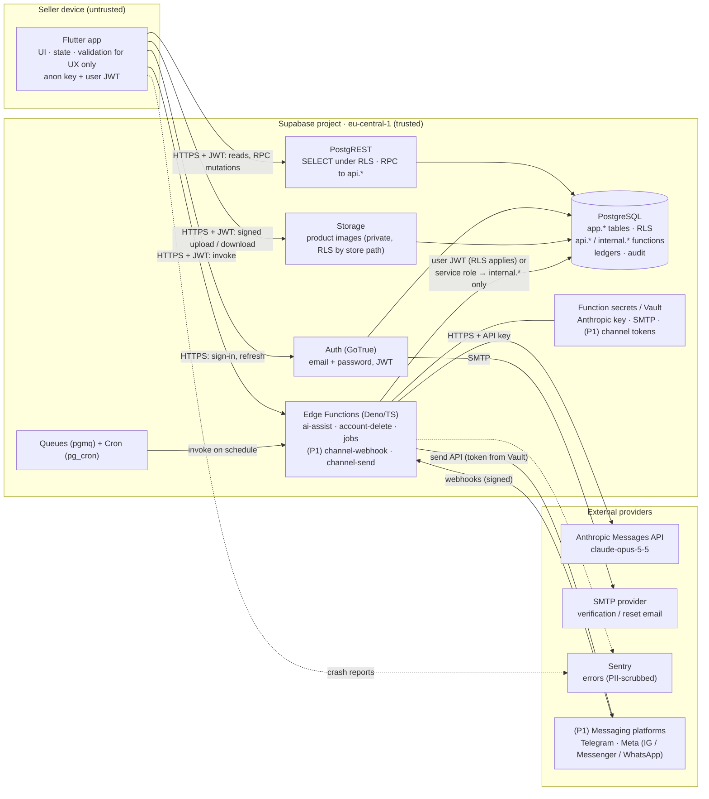
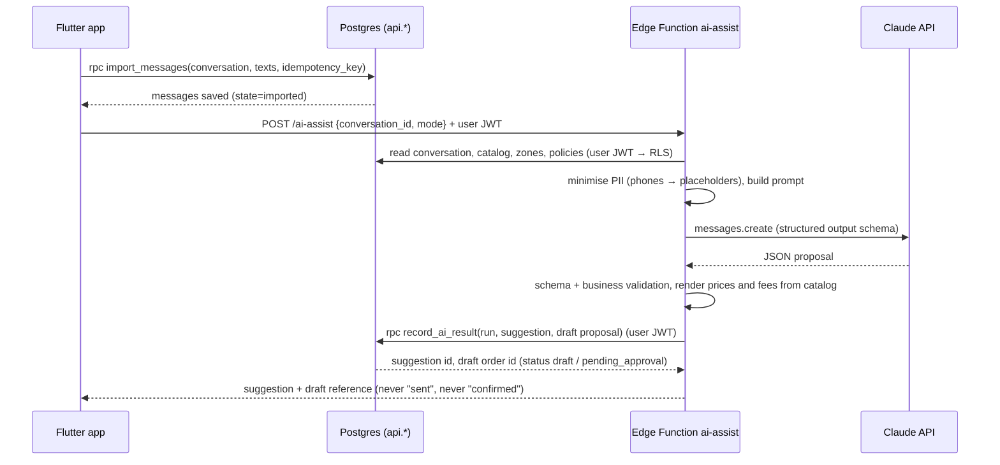

# Architecture overview

**Phase 3** · Status: **Proposed — pending owner approval** · Decisions: [technology-decisions.md](technology-decisions.md), [ADRs](architecture-decision-records/README.md)

## 1. Summary

Aisellia is a **Flutter app backed by a single Supabase project per environment**.
- **PostgreSQL** is the system of record and the enforcement point for business rules: row-level security for reads, and `api.*` database functions for every mutation.
- **Edge Functions** host the work SQL cannot do: calling Claude, handling external webhooks (P1), account deletion, and scheduled jobs.
- **Nothing privileged runs on the device.**
- The **AI produces proposals only**. Approval is an owner-only database function that rejects any non-user caller.

## 2. System diagram

## 3. Components

| Component | Responsibility | Trust boundary | Data access | Communication | Failure modes | Security requirements | Operational dependencies |
|---|---|---|---|---|---|---|---|
| **Flutter app** | UI, navigation, UX validation, local session, image compression, clipboard copy | **Untrusted** device | Only what RLS returns for the signed-in user | HTTPS to Supabase; Sentry SDK | Offline, expired session, timeouts, app killed | No secrets beyond the public anon key; tokens in Keychain or Keystore; certificate validation by the OS; no business rule trusted client-side | App stores; build pipeline |
| **Supabase Auth** | Accounts, email verification, password reset, JWT issuance and refresh | Trusted (managed) | `auth.users` | HTTPS; SMTP out | SMTP outage (no verification mail); rate limits | Rate limits on; custom SMTP; short access-token TTL (default 1 h) with refresh rotation | SMTP provider |
| **PostgREST** | Exposes SELECT on views and tables and RPC to `api.*` | Trusted (managed) | As the `authenticated` role, under RLS | HTTPS ⇄ app | DB unavailable; statement timeouts | Only schemas `api` and read views exposed; `internal` and `app` write paths not callable by users | DB |
| **PostgreSQL** | System of record; invariants; transactions; RLS; ledgers; audit; idempotency | **Trusted core** | All business data | SQL | Disk full, connection limit, failed migration | SELECT-only grants for users; definer functions with explicit checks; constraints; backups | Supabase platform |
| **Storage** | Product images, store logo | Trusted (managed) | Objects under `/{store_id}/…` | HTTPS with JWT; signed URLs | Upload failures; large files | Private buckets; RLS on `storage.objects` by `store_id` prefix and membership; size and type limits; EXIF stripped client-side and verified server-side where feasible | DB |
| **Edge Functions** | `ai-assist`, `account-delete`, scheduled jobs; P1 `channel-webhook` and `channel-send` | Trusted (managed runtime) | **User JWT** for user-initiated work (RLS applies); **service role only** to call `internal.*` functions for system work | HTTPS in and out | Timeouts (400 s wall clock, 2 s CPU *verify*), provider errors, cold starts | Secrets only from function secrets or Vault; JWT verification; per-store rate limits; no logging of message bodies | Anthropic, SMTP, (P1) channel APIs |
| **Queues and Cron** | Retryable async work; schedules (reconciliation, purges, deletions) | Trusted | DB | SQL; `pg_net` to Edge Functions | Stuck or poison messages | Dead-letter handling; idempotent consumers | DB |
| **Anthropic API** | Language understanding and structured proposals | **External** | Only the minimised context sent per request | HTTPS | Timeouts, 429, 5xx, refusals, malformed output | API key server-side only; data-retention terms reviewed (AD-08); no PII beyond necessity | Network |
| **SMTP provider** | Auth emails | External | Recipient email, templated link | SMTP over TLS | Delivery delays | Credentials in Supabase settings only | — |
| **Sentry** | Crash and error aggregation | External | Stack traces, error IDs, PII-scrubbed context | HTTPS | Quota exhaustion | Scrubbing rules; no request bodies, no phones or addresses | — |
| **Messaging platforms (P1)** | Inbound and outbound customer messages | External | Message content for connected accounts | Webhooks in, Send APIs out | Duplicates, reordering, token expiry, window limits | Signature verification; tokens in Vault; deduplication | Platform approvals |

## 4. What runs where

| Device | Trusted server (Supabase) | External providers |
|---|---|---|
| Rendering, navigation, form UX validation, offline detection, clipboard, image capture and compression, idempotency-key generation, retry UI | Authorization, all business validation, order and stock transitions, totals, idempotency, audit, AI orchestration and validation, rendering of authoritative values into replies, webhook verification, scheduled jobs, backups | Model inference, email delivery, crash aggregation, (P1) message transport |

**Credentials:** the Anthropic key, SMTP credentials, the service-role key, webhook secrets and channel tokens exist **only** in Supabase function secrets, Vault or Auth settings, and in CI secret stores for deployment. None are in the repository or the app bundle ([deployment-and-operations.md §3](deployment-and-operations.md#3-configuration-and-secrets)).

## 5. Key data flows

### 5.1 Inquiry to suggestion to draft (Stage A, manual import)

### 5.2 Approval
`App → rpc api.approve_order(order_id, expected_version, idempotency_key, price_choices)`.
- The function runs one transaction: authorize (owner, verified email, end-user JWT), lock the order, re-validate, lock variants, write the ledger, set the status and history, and store the idempotency response.
- The App then offers the confirmation text to copy (Stage A). See [backend-and-data-model.md §6](backend-and-data-model.md#6-critical-transactions).

### 5.3 Webhook ingestion (P1)
`Platform → channel-webhook`: verify the signature, insert `webhook_events` (unique per external event ID; duplicates are ignored), return 200 quickly, enqueue. The consumer normalises the event into a conversation and message, then optionally triggers `ai-assist` in system context. That context **can only create drafts and suggestions**.

## 6. Non-negotiable architectural invariants
1. No privileged credential on the device.
2. Users cannot write business tables directly; all mutations are `api.*` functions with explicit authorization.
3. Approval only by an authenticated human owner (or, in P1, an explicitly permitted staff member) through `api.approve_order`.
4. Stock changes only through ledger-writing functions; the balance always equals the sum of movements, and is never negative.
5. Every status change is an allowed transition and produces exactly one history event.
6. AI outputs are proposals; prices, fees and totals come from the database.
7. "Sent" is recorded only from a provider acceptance (P1); Stage A records "copied" or "marked as sent by you".
8. Every external event is deduplicated before processing.
