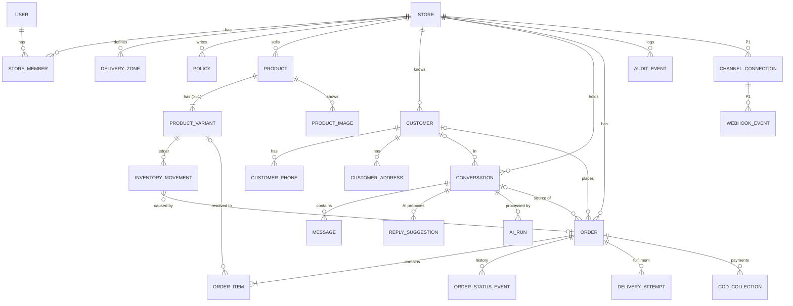

# Backend and data model

**Phase 3** · Status: **Proposed — pending owner approval** · Related: [ADR-002](architecture-decision-records/ADR-002-mutations-through-database-functions.md), [ADR-003](architecture-decision-records/ADR-003-tenant-isolation.md), [ADR-004](architecture-decision-records/ADR-004-inventory-policy.md), [ADR-005](architecture-decision-records/ADR-005-idempotency-and-concurrency.md) · [Authorization](authorization-and-tenancy.md) · [Contracts](api-and-service-contracts.md)

This is a **conceptual and logical** model. Exact DDL, migrations and Dart models are written in Phases 5–8. The approval path was prototyped ([proof](proofs/approval-consistency/README.md)).

## 1. Backend responsibilities and schemas

| Schema | Contents | Who can use it |
|---|---|---|
| `auth` | Supabase-managed users and sessions | Supabase Auth; read by definer functions (for example the email-verified check) |
| `app` | Business tables, helper functions (`is_member`, `require_permission`), triggers, read views | `authenticated`: **SELECT only**, filtered by RLS. No writes. |
| `api` | Public mutation functions (`SECURITY DEFINER`, `search_path = ''`) | `authenticated` via RPC; each function authorizes explicitly |
| `internal` | System-only functions (AI result write-back in system context, webhook ingestion, jobs, purges, deletions) | `service_role` only; **never** exposed to PostgREST |
| `storage` | Supabase Storage objects and policies | Policies by store path |

Edge Functions: `ai-assist`, `account-delete`, `jobs-*` (scheduled); P1: `channel-webhook-<channel>` and `channel-send`.

## 2. Modelling conventions
- **Identifiers:** UUID primary keys (`gen_random_uuid()`), plus a human-readable `orders.number` per store.
- **Tenancy:** every business table has `store_id uuid not null`. Child tables reference parents with **composite foreign keys** `(store_id, parent_id) → parent(store_id, id)`, so a row cannot point to another store's row even through a buggy function.
- **Mutable rows** carry `created_at`, `updated_at` and `version int` (incremented by every mutation function; used for optimistic concurrency).
- **Status fields:** `text` with `CHECK` constraints rather than Postgres enums, so values can be added without type migrations. Transitions are enforced in functions.
- **Money:** `integer` in the store currency (no fractions, Phase 1 BR-12). Quantities are `integer`. No floating point.
- **Phones:** stored normalised in E.164 (`+9647…`); the original input is not kept.
- **Immutable history** (append-only, no UPDATE or DELETE grants even inside functions except purge jobs): `inventory_movements`, `order_status_events`, `cod_collections`, `audit_events`, `webhook_events` (payload purge only).
- **Mutable current state:** stores, settings, products, variants (including `stock_on_hand` as a maintained balance), customers, conversations, orders (current status and fields).
- **Deliberate duplications, each with a reason:**
  1. `product_variants.stock_on_hand` duplicates the sum of movements, for row locking and cheap reads; a scheduled reconciliation checks it (ADR-004).
  2. Order customer and delivery snapshots, which keep the address and phone *as used for that order*; they are anonymised together with the customer.
  3. Order line name, variant and price snapshots, which keep the history accurate after catalog edits (Phase 1 INV-6).
  4. Order totals, computed by functions and stored for reporting; a test recomputes them.

## 3. Entity relationship overview

## 4. Entities

Legend:
- **PK** = primary key; **U** = unique; **FK** = foreign key.
- **Sensitive**: P = personal data; B = business-confidential; S = secret.
- **Retention**: see §7.

### 4.1 Identity and tenancy
| Entity | Purpose | Key fields | Identifiers and relations | Tenant | Sensitive | Lifecycle and validation |
|---|---|---|---|---|---|---|
| **auth.users** (Supabase) | Login identity | email, encrypted password, `email_confirmed_at` | PK id | Global | P (email), S (password hash) | Deleted via `account-delete` after the 14-day grace (D-13) |
| **profiles** | App-level user settings | `user_id`, `display_name`, `ui_locale`, `digit_style`, `theme`, `reduced_motion` | PK = FK `user_id` | Per user | P (name) | Created at sign-up |
| **stores** | Tenant and business profile | `name`, `contact_phone`, `currency` (IQD/USD), `reply_locale`, `business_city`, `low_stock_default`, `cod_enabled`, `other_payment_enabled`, `currency_locked_at`, `last_order_number`, `deletion_requested_at` | PK id | Is the tenant | B, P (contact phone) | Currency immutable once `currency_locked_at` is set (first approval); deletion is two-step |
| **store_members** | Who may act in a store | `store_id`, `user_id`, `role` (owner/staff), `permissions` (P1 flags), `status` | PK (`store_id`, `user_id`); U: one `owner` per store (partial unique index) | Store | — | P0: exactly one owner; staff in P1 |
| **delivery_zones** | Seller-defined fees the AI may quote | `name`, `fee` ≥ 0, `time_text`, `active`, `sort` | U (`store_id`, lower(`name`)) | Store | B | Deactivated rather than deleted when referenced |
| **policies** | Seller-approved statements for the AI | `topic`, `body` (≤ 1,000 characters), `active` | — | Store | B | Edits audited |

### 4.2 Catalog and inventory
| Entity | Purpose | Key fields | Identifiers and relations | Tenant | Sensitive | Lifecycle and validation |
|---|---|---|---|---|---|---|
| **products** | Sellable item | `name` (1–120), `description` (≤ 2,000), `category`, `base_price` > 0, `track_stock`, `option_types` (≤ 2 names), `status` (active/inactive/archived), `search_text` (normalised) | U (`store_id`, `id`) | Store | B | Archived instead of deleted when referenced (BR-17) |
| **product_variants** | Purchasable unit; holds the stock balance | `product_id`, `option_values` (jsonb), `label`, `sku`, `price_override`, `stock_on_hand` ≥ 0 (CHECK), `available` (untracked), `low_stock_threshold`, `status` | U (`store_id`, `sku`) where `sku` is not null; U (`product_id`, `option_values`); FK (`store_id`, `product_id`) | Store | B | ≥ 1 per product (the default variant when there are no options); ≤ 100 per product; `stock_on_hand` is changed only by ledger functions |
| **product_images** | Media references | `product_id`, `storage_path` (`{store_id}/products/{product_id}/{uuid}.jpg`), `position`, `width`, `height`, `status` (pending/ready/failed) | FK (`store_id`, `product_id`) | Store | Low | ≤ 5 per product; the object is removed when the row is deleted |
| **inventory_movements** | Append-only stock ledger | `variant_id`, `delta` ≠ 0, `resulting_qty` ≥ 0, `reason` (initial_stock, received, sold_in_shop, damaged, count_correction, other, order_approved, order_edited, order_cancelled, order_returned_restock), `note`, `order_id`, `actor_user_id`, `created_at` | FK (`store_id`, `variant_id`); FK (`store_id`, `order_id`) | Store | B | Immutable; Σ`delta` per variant = `stock_on_hand` (reconciled nightly) |

### 4.3 Customers and conversations
| Entity | Purpose | Key fields | Identifiers and relations | Tenant | Sensitive | Lifecycle and validation |
|---|---|---|---|---|---|---|
| **customers** | Buyer record | `display_name`, `notes`, `anonymized_at` | — | Store | **P** | Anonymisation replaces the name and notes, deletes phones and addresses, and anonymises order snapshots (BR-72) |
| **customer_phones** | Lookup and matching | `customer_id`, `phone_e164`, `label` | Index (`store_id`, `phone_e164`) (not unique: the match is only *suggested*, US-041) | Store | **P** | Deleted on anonymisation |
| **customer_addresses** | Reusable delivery addresses | `customer_id`, `zone_id`, `city_text`, `area`, `landmark`, `details` | — | Store | **P** | Deleted on anonymisation |
| **conversations** | Thread with one customer from one source | `customer_id` (nullable), `source` (manual:instagram/whatsapp/messenger/telegram/phone/other, sandbox, P1 live:<channel>), `channel_connection_id` (P1), `is_sandbox`, `status` (needs_reply, needs_you, waiting, closed), `escalation_reason`, `last_activity_at` | — | Store | P (via content) | Sandbox conversations are always `is_sandbox = true`; they cannot be linked to live channels |
| **messages** | One inbound or outbound message | `conversation_id`, `direction` (in/out), `origin` (imported, channel, seller_written, ai_reply_copied), `body`, `state` (imported, received, copied, marked_sent, sending, sent, failed, unknown), `external_message_id` (P1), `reply_suggestion_id` | U (`channel_connection_id`, `external_message_id`) where not null | Store | **P** | `sent` only when the provider accepted (INV-9); bodies follow retention (§7) |
| **reply_suggestions** | AI proposal, kept separate from messages | `conversation_id`, `ai_run_id`, `text_rendered`, `facts_used` (ids), `missing_fields`, `escalation`, `status` (suggested, copied, dismissed, superseded) | — | Store | P (content) | Never itself a message; copying creates an outbound message with state `copied` |
| **ai_runs** | Traceability, quality and cost record | `kind` (reply, extraction), `conversation_id`, `input_message_ids`, `model`, `prompt_version`, `effort`, `status` (succeeded, invalid_output, timeout, provider_error, refused, rate_limited), `latency_ms`, token counts (input, output, cache read, cache write), `cost_estimate_minor`, `validation_errors`, `output_json` | — | Store | P (output) | `output_json` purged after 90 days (D-13); metrics kept 24 months |
| **channel_connections** (P1) | Authorised link to a platform | `channel`, `external_account_id`, `status` (connecting, connected, needs_attention, disconnected), `token_secret_id` (Vault reference), `scopes`, `last_event_at`, `last_error` | U (`channel`, `external_account_id`) | Store | **S** (token in Vault only) | Disconnect revokes and deletes the Vault secret |
| **webhook_events** (P1) | Inbound event log for deduplication and replay | `channel`, `external_event_id`, `connection_id`, `received_at`, `signature_valid`, `payload` (jsonb), `processing_status`, `attempts`, `last_error` | U (`channel`, `external_event_id`) | Resolved store (nullable until routed) | **P** | Payload purged after 14 days; key kept 90 days |

### 4.4 Orders and fulfilment
| Entity | Purpose | Key fields | Identifiers and relations | Tenant | Sensitive | Lifecycle and validation |
|---|---|---|---|---|---|---|
| **orders** | Draft through terminal order (Phase 1 §6.4) | `number`, `status` (draft, pending_approval, rejected, approved, processing, dispatched, delivered, delivery_failed, returned, cancelled), `origin` (ai, manual), `is_test`, `conversation_id`, `customer_id`, customer snapshot (`cust_name`, `cust_phone`, `cust_phone2`), delivery snapshot (`zone_id`, `zone_name`, `delivery_fee`, `city_text`, `area`, `landmark`, `details`), `payment_method` (cod, other), `discount`, `subtotal`, `total`, `cod_due`, `cod_collected`, `customer_note`, `internal_note`, `provenance` (jsonb field → {source, message_id, excerpt_ref}), `version`, `approved_by`, `approved_at`, `closed_reason` | U (`store_id`, `number`) | Store | **P** | Status changes only through `api.*` transitions; required-field completeness is computed by the server (draft ↔ pending_approval) |
| **order_items** | Lines | `order_id`, `variant_id` (nullable while unresolved), `resolution` (resolved, choose_product, variant_needed, not_in_catalog), `candidate_variant_ids`, `customer_text_ref`, `name_snapshot`, `variant_label_snapshot`, `quantity` 1–999, `quantity_basis` (stated, inferred, confirmed), `quoted_unit_price`, `approved_unit_price`, `provenance` | FK (`store_id`, `order_id`); FK (`store_id`, `variant_id`) | Store | B | Approval requires every line `resolved` with a non-inferred quantity |
| **order_status_events** | Immutable lifecycle history | `order_id`, `from_status`, `to_status`, `actor_user_id` or `actor_system`, `reason`, `created_at` | — | Store | Low | Exactly one per transition |
| **delivery_attempts** | Fulfilment records | `order_id`, `courier_note`, `dispatched_at`, `outcome` (pending, delivered, failed), `failure_reason` | — | Store | Low | One open attempt at a time |
| **return_lines** | Per-line return decision | `order_id`, `order_item_id`, `restock_qty`, `writeoff_qty` | U (`order_item_id`) | Store | B | Restock creates movements; write-off creates none (reported) |
| **cod_collections** | Cash collected | `order_id`, `amount` > 0, `recorded_by`, `created_at` | — | Store | B | Σ amount ≤ `cod_due`; `orders.cod_collected` is maintained |

### 4.5 Security and operations
| Entity | Purpose | Key fields | Notes |
|---|---|---|---|
| **audit_events** | Who did what (BR-63) | `store_id`, `actor_user_id` / `actor_system`, `action`, `entity_type`, `entity_id`, `before`, `after` (minimal diffs; no secrets), `request_ref`, `created_at` | Append-only; personal values in diffs are anonymised with the customer |
| **idempotency_keys** | Safe retries | PK (`user_id`, `key`), `operation`, `request_hash`, `response`, `created_at` | Purged after 7 days |
| **job_runs** | Scheduled job outcomes (reconciliation, dumps, purges) | `job`, `started_at`, `finished_at`, `status`, `details` | Alerts on failure |
| **account_deletion_requests** | Grace-period deletion | `user_id`, `store_id`, `requested_at`, `execute_after`, `status` | Executed by a scheduled job |
| **ai_usage_daily** (view or materialised) | Cost monitoring | `store_id`, `day`, calls, tokens, estimated cost | Derived from `ai_runs` |

Not modelled in P0: subscriptions and billing, staff invitations (P1), push tokens (P1), outbound send attempts (P1; `channel_send_attempts` with `provider_message_id` and state).

## 5. Constraints, indexes, deletion

**Integrity constraints** (beyond those in §4):
- `CHECK (stock_on_hand >= 0)`
- `CHECK (quantity between 1 and 999)`
- `CHECK (discount between 0 and subtotal)`
- `CHECK (fee >= 0)` and `CHECK (price > 0)`
- `CHECK (status in (…))`
- One owner per store (partial unique index)
- Order number unique per store, allocated by `UPDATE stores SET last_order_number = last_order_number + 1 … RETURNING` inside the creating transaction

**Indexes** (initial; validated with `EXPLAIN` in Phase 6–7):

| Table | Index |
|---|---|
| orders | (`store_id`, `status`, `created_at` desc); (`store_id`, `number`) U; (`store_id`, `customer_id`); (`store_id`, `conversation_id`) |
| order_items | (`order_id`); (`store_id`, `variant_id`) |
| products / variants | (`store_id`, `status`); trigram GIN on `products.search_text` and `variants.label`/`sku` (`pg_trgm`) for search and AI candidate pre-filtering |
| inventory_movements | (`variant_id`, `created_at` desc); (`store_id`, `order_id`) |
| customers / phones | (`store_id`, `phone_e164`); trigram on `display_name` |
| conversations / messages | (`store_id`, `status`, `last_activity_at` desc); (`conversation_id`, `created_at`) |
| audit_events | (`store_id`, `entity_type`, `entity_id`, `created_at`) |
| ai_runs | (`store_id`, `created_at`) |
| webhook_events | U (`channel`, `external_event_id`); (`processing_status`, `received_at`) |

**Deletion behaviour:**
- Foreign keys default to `ON DELETE RESTRICT`. Records referenced by orders are archived, never deleted.
- `product_images` cascade from products only for never-referenced products.
- Customer deletion means anonymisation (the order financial facts stay).
- Store deletion means a scheduled job deletes in dependency order after the grace period, then removes Storage objects, then the Auth user.

## 6. Critical transactions

All of these are single database transactions inside `api.*` functions, at READ COMMITTED isolation with explicit `SELECT … FOR UPDATE` row locks. Variants are always locked **in ascending id order** to avoid deadlocks.

### 6.1 Draft creation (AI or manual)
- **Creates:** an `orders` row with status `draft` or `pending_approval` (computed from completeness), `order_items` (possibly unresolved), `provenance`, `order_status_events` (`∅ → draft` or `pending_approval`), and an `audit_events` row. AI drafts also link `ai_run_id` and the conversation.
- **Must not happen:** inventory movements, `currency_locked_at`, COD due, customer confirmation text, inclusion in reports (the reporting views filter `status in committed statuses and not is_test`).
- **Duplicate protection:** one *open* AI draft per conversation. AI re-processing **updates** that draft (only fields that are empty or not edited by the seller; BR "seller edits win") rather than creating a second one. Draft creation carries an idempotency key.
- **Test orders:** `is_test` is copied from the sandbox conversation and cannot be changed afterwards.

### 6.2 Approval: `api.approve_order(order_id, expected_version, idempotency_key, price_choices)`
Steps:
1. Idempotency lookup.
2. Caller must be an end-user JWT (`auth.role() = 'authenticated'`; `service_role` is rejected), an owner (or staff with `can_approve`, P1), with a verified email.
3. Lock the order.
4. Check status `pending_approval` and version.
5. Re-check completeness (BR-36).
6. Lock the variants.
7. Re-validate each line: active, price versus quote, stock.
8. Write movements and decrement balances (not for test orders or untracked variants).
9. Set approved prices, totals, `cod_due`, status, `approved_by`/`at`, and version+1.
10. Set `currency_locked_at` if unset.
11. Write the status event and audit.
12. Store the idempotency response.

| Situation | Outcome |
|---|---|
| Product price changed since the quote | `PRICE_CHANGED` with quoted and current values. The seller resubmits with `price_choices[item] = quoted\|current` (BR-23). |
| Stock decreased below the requested quantity | `INSUFFICIENT_STOCK` with per-line requested and available; nothing changes |
| Product or variant became inactive or archived | `LINE_UNAVAILABLE` with the lines |
| Draft edited elsewhere (version mismatch) | `CONFLICT_VERSION` with the current version; the client reloads |
| Required customer or delivery data missing | `INCOMPLETE_ORDER` with the missing fields (status cannot be pending in that case; a defensive check) |
| Two approval requests close together | The order row lock serialises them: the first approves, the second sees status `approved` and gets `INVALID_TRANSITION` with `current_status=approved`, which the client shows as success-already (prototype T6) |
| Same request retried (same key) | The stored response is replayed; no side effects (T11) |
| Session expired | 401 before the function runs; the client refreshes and retries with the **same key** |
| Timeout but committed remotely | The client re-reads the order or replays the key and receives the original success |
| Caller is the AI or system (`service_role`) | `FORBIDDEN` (T5) |
| Unverified email | `EMAIL_NOT_VERIFIED` |

### 6.3 Inventory policy across the lifecycle (Phase 1 F, ADR-004)
| Event | Stock effect | Function |
|---|---|---|
| Draft created or edited | None | `api.*draft*` |
| Approve | −qty per tracked line (atomic; all-or-nothing) | `approve_order` |
| Edit before dispatch | Difference: increases are checked and decremented, decreases restored (atomic) | `edit_approved_order` |
| Cancel (approved or processing) | +qty for all tracked lines | `cancel_order` |
| Dispatch, delivered, delivery failed | None | `transition_order` |
| Returned | Per line: restock +qty, or write off (no movement; `return_lines` record) | `record_return` |
| Manual adjustment | ±qty with reason; result ≥ 0 | `adjust_stock` |
| Test order or untracked variant | Never | — |

Reservations are not used in P0 (ADR-004). Prohibited: any direct stock update, negative results, a second deduction for the same order (guarded by status transition plus idempotency), restocking twice (returned is terminal, and `return_lines` is unique per item).

### 6.4 Idempotency inventory
| Operation | Duplicate source | Detection | Safe retry |
|---|---|---|---|
| Approve, reject, cancel, transitions, return, COD record | Double-tap, retry after timeout | `idempotency_keys` (`user_id`, key) + status-transition guard | Replay the stored response |
| Stock adjustment | Retry | `idempotency_keys` | Replay |
| Import messages | Retry | Idempotency key | Replay (no duplicate messages) |
| Create product or manual order | Retry | Idempotency key | Replay (returns the same id) |
| AI assist | Retry or regenerate | A per-request key; one open draft per conversation | A retry replays the stored suggestion; **Regenerate** is a new intent with a new key and supersedes the previous suggestion |
| Webhook delivery (P1) | Platform redelivery | U (`channel`, `external_event_id`) and U (`connection_id`, `external_message_id`) | Duplicates are acknowledged and ignored |
| Background jobs | Visibility-timeout redelivery | Consumers are idempotent by design (upserts keyed on business IDs); `job_runs` | Re-run is harmless |
| Customer confirmation send (P1) | Retry after timeout | `channel_send_attempts` keyed by (`message_id`, attempt) + provider idempotency where supported | **Reconcile before resend** ([messaging §8](messaging-integration-architecture.md#8-outbound-messages-and-unknown-outcomes)) |

### 6.5 Order history and prohibited transitions
- **Current state:** `orders.status` is maintained by functions. **History:** `order_status_events`, one per transition, plus `audit_events` for field edits.
- **Allowed transitions:** exactly Phase 1 BR-30. Each transition function validates `from → to` against a single SQL transition table (`app.order_transitions`), which is also used by tests.
- **Prohibited**, and enforced by the server:
  - anything to `approved` except from `pending_approval` via `approve_order`;
  - `dispatched` without complete delivery details;
  - `delivered` except from `dispatched`;
  - any transition out of a terminal status;
  - any client write to `status`, because there are no table grants.
- There is **no generic "set status" operation.** Fulfilment completion (`delivered`) cannot be fabricated without an owner session and a prior `dispatched` state.

## 7. Data lifecycle, retention and privacy

> Proposed retention periods are **product decisions requiring owner approval (AD-06)** and **legal review** (see §7.3). Nothing here is a claim of legal compliance.

### 7.1 Retention
| Data | Necessary because | Who may access | Proposed retention |
|---|---|---|---|
| Product images, store logo | Catalog | Store members | While the product or store exists; deleted with them |
| Customer contact info (name, phones, addresses) | Delivery and order handling | Store members | While the store is active; removed on seller request (anonymisation) or store deletion |
| Message content (imported or received) | Context for replies and drafts | Store members; sent to the AI provider per request | **12 months** after the last conversation activity, then bodies purged (metadata kept) |
| Orders (with snapshots) | Business records, disputes, reporting | Store members | Life of the store (legal minimum for commercial records in Iraq/KRI is **unknown**) |
| AI run outputs | Debugging, quality evaluation | Store members (via the draft); Aisellia support with consent | 90 days (D-13); token and cost metrics 24 months |
| AI prompts (inputs) | Not stored as text; only message IDs and catalog version references | — | — |
| Webhook payloads (P1) | Replay and debugging | System | 14 days; deduplication key 90 days |
| Application logs (Supabase) | Operations | Aisellia operators | Platform retention (plan-dependent, *verify*); no bodies or phones logged |
| Sentry events | Crash diagnosis | Aisellia operators | Plan retention (*verify*); PII scrubbed |
| Audit events | Accountability | Store owner (own store); operators with consent | 24 months minimum (proposal) |
| Backups and dumps | Recovery | Operators only (break-glass) | Platform 7 days; nightly encrypted dumps 30 days. Deleted data persists in backups until they expire (disclosed in the privacy policy) |
| Exports | Not offered in P0 | — | — |

### 7.2 Redaction rules
- Logs and errors never contain: message bodies, AI prompts or outputs, phone numbers, addresses, emails, tokens, keys, passwords, or full request bodies.
- Use IDs and error codes instead.
- Sentry `beforeSend` and Edge Function loggers apply the same scrubber (regexes for phone, email and JWT shapes).
- Audit `before`/`after` store field-level changes. Customer personal values in audit rows are anonymised with the customer.

### 7.3 Questions the owner must verify with qualified counsel before commercial launch
1. Applicable data-protection rules for personal data of customers in Iraq and the Kurdistan Region, and any registration or consent requirements.
2. Lawfulness of transferring customer data to processors outside Iraq: Supabase (EU, Frankfurt), Anthropic (US), Sentry, the SMTP provider.
3. Minimum retention for commercial and tax records of orders.
4. Required content of the seller-facing privacy policy and terms, including the seller's role toward their customers (controller and processor relationship).
5. Meta, WhatsApp and Telegram platform terms on storing and processing message content (Phase 9).
6. App Store and Google Play privacy disclosures (Data Safety, privacy nutrition labels).
