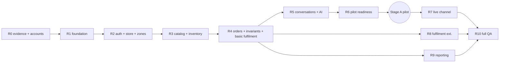

# Implementation roadmap

**Phase 3** · Status: **Proposed — pending owner approval.** No dates are given, because team capacity is unknown. Effort uses relative sizes (S/M/L/XL), as in Phase 1 §13.

**Phase order:** the master phase sequence is kept. Two adjustments proposed in Phase 1 (**D-09, still pending**) are assumed here, because of concrete dependencies:
- **Delivery zones in Phase 5:** the AI needs fees to answer delivery questions.
- **Minimal fulfilment and COD in Phase 7:** the order state machine and inventory rules cannot be tested without the transitions.

The Stage A pilot can therefore start after Phase 8 and a Phase 12 subset, *before* Phase 9 (live channels). If D-09 is declined, Phases 9–11 run in master order before any pilot.

## 0. Gate before implementation (R0: evidence and accounts)
| Item | Why | Owner action |
|---|---|---|
| **Supabase reachability and latency from Iraqi networks** (pilot sellers' mobile and fixed ISPs; test the `*.supabase.co` API, Auth and Storage from a free test project) | ADR-001 and ADR-009 depend on it; documented regional blocks elsewhere | Run the test from real devices (we provide a simple test page or script in Phase 4 setup, or before) |
| Environment network policy: allow `dl.google.com` (Android SDK) and the Supabase hosts | The cloud dev environment cannot build Android or reach Supabase today (Phase 0) | Update the environment settings |
| Accounts: Supabase organisation, Anthropic (separate keys per environment), Sentry, SMTP provider, Apple Developer, Google Play, a domain | Provisioning in Phases 4–5 | Owner creates the accounts; MFA on all of them |
| Approvals: D-01–D-15, DD-01–DD-13, AD-01–AD-12 | Expensive-to-reverse choices | Owner decision |
| M0 product evidence (Phase 1 §13): pilot sellers, consented conversation samples for the AI evaluation set | Phase 8 quality gates | Owner and team |

## 1. Milestones
| # | Milestone (phase) | Scope | Prerequisites | Validation required | Major risks | Size |
|---|---|---|---|---|---|---|
| **R1** | Foundation (Phase 4) | Flutter project (flavors, config, lints, import-boundary check, token codegen, design-system primitives and patterns, shell with per-tab stacks, l10n including the `ckb` delegate check, debug gallery, representative screens on labelled fixtures); Supabase repository skeleton (`supabase/` with an empty schema, the **RLS and privilege baseline**, `require_*` helpers, the negative-test generator harness); CI stages 1–5 | R0 | Phase 2 checklist on the representative screens; CI green; golden tests in `en`/`ckb`; harness proves deny-by-default | Flutter `ckb` support gaps; Sorani rendering on devices | L |
| **R2** | Auth and store setup (Phase 5) | Auth with custom SMTP; profiles; stores; members (owner); **zones**; payments; policies; onboarding flow; account deletion (grace job); secure session storage | R1; SMTP and domain | NT suite for the new tables and functions; restart persistence; US-001–009 | Email deliverability; Auth configuration | L |
| **R3** | Catalog and inventory (Phase 6) | Products and variants, images (Storage policies), stock adjustments, ledger, reconciliation job, search (trigram) | R2 | pgTAP for limits, SKU, ledger invariant; NT-07; US-010–019 | Variant UX complexity | L |
| **R4** | Orders and invariants (Phase 7) | Customers; orders (manual); draft review; **approve, reject, edit, cancel; fulfilment transitions; returns; COD**; history; audit; idempotency; reporting views. The prototype becomes real migrations and tests. | R3 | Transition matrix exhaustive tests; concurrency and property tests; E2E journeys 3–5; US-029–043 | Concurrency bugs (mitigated by the prototype) | XL |
| **R5** | Conversations and AI (Phase 8) | Inbox, import, sandbox; `ai-assist` with the provider interface; PII minimiser; renderer and guard; draft merge; `ai_runs`; rate limits and caps; evaluation harness | R4; M0 dataset; Anthropic key; AD-07, AD-08 | Deterministic AI tests; **evaluation gates met**; E2E journey 2 | Sorani quality; cost; latency | XL |
| **R6** | Pilot readiness (Phases 11-lite and 12-lite) | Today and summary; offline and error polish; Sentry; nightly dumps; **restore rehearsal**; release signing; TestFlight and Play internal; privacy policy and terms; pilot onboarding materials | R2–R5 | Pre-pilot security gate; release gates; device scripts | iOS build access; store review of privacy texts | M |
| — | **Stage A pilot** | — | R6 | — | — | — |
| **R7** | First live channel (Phase 9) | Adapter for the channel chosen by D-02, webhook ingestion, send queue, reconciliation, health, push notifications | Stage A evidence; platform approval | Messaging tests; documented end-to-end test on a real account | Platform approval timeline | L–XL |
| **R8** | Fulfilment extensions (Phase 10) | Courier records, delivery lists, payment recording (P1) | R4 | Per feature | — | M |
| **R9** | Reporting (Phase 11) | Reports with metric definitions and date filters | R4 | Reconciliation tests | — | M |
| **R10** | Full QA and release (Phase 12) | Full accessibility, performance, security review, PITR, release-readiness assessment | All | Phase 12 criteria | — | L |

## 2. Dependency graph

## 3. Expensive-to-reverse decisions and how they are reviewed
| Decision | Why it is expensive | Review mechanism |
|---|---|---|
| Backend platform (ADR-001) | Data, auth and functions are all bound to it | R0 reachability evidence + owner approval; reconsideration triggers in the ADR |
| Region (ADR-009) | Moving region means migrating the project | R0 latency measurements |
| Tenant model: `store_id` and composite FKs (ADR-003) | Touches every table | Negative-test harness in R1 before any business table |
| Mutation-through-functions (ADR-002) | Shapes every feature | Proven in the prototype; reviewed after R3 (maintainability check) |
| Order state model (D-05) | Data and UI everywhere | Exhaustive transition tests in R4 |
| App identifiers and signing keys (AD-10) | Store listings and updates are bound to them | Decided before the first store upload |
| AI provider data terms (AD-08) | Customer data leaves the system | Owner review before Stage A |

Changes to any of these require an updated ADR and owner approval before code changes.

## 4. Acceptance conditions for starting Phase 4
1. The owner approves (or amends) the Phase 3 architecture and AD-01–AD-12. Phase 1 and Phase 2 decisions are approved or explicitly accepted as the working baseline.
2. The R0 reachability result is available, **or** the owner explicitly accepts the risk of starting R1 before it. R1 does not depend on a hosted project.
3. Environment network access for the Android SDK is allowed, **or** Android builds are delegated to CI or the owner's machine.
4. The owner confirms who provides the macOS and iOS build capability.

## 5. Progress (updated 2026-10-18)

The milestones above are unchanged. Current status is kept in [project-status.md](../../implementation/project-status.md); in short:
- **Done locally:** R1–R5, Phase 8.5, R7 (Phase 9, six providers) and R8 (Phase 10, fulfilment extensions). All of it is local only.
- **Next:** R9 (Phase 11, reporting).
- **Not started:** R6 (needs external accounts and the owner's approval), R9 and R10.

**Owner decision (2026-10-18):** all real Gemini API calls, including the 35-conversation real-model evaluation and native review of real outputs, are **deferred to the final pre-publication verification** ([checklist](../../implementation/pre-publication-checklist.md)).

**About the "phase-10" folder.** The Gemini verification work done before this decision was requested under the name "Phase 10" and lives in `docs/implementation/phase-10/gemini-readiness.md`. It is a Phase 9 follow-up, not R8.
