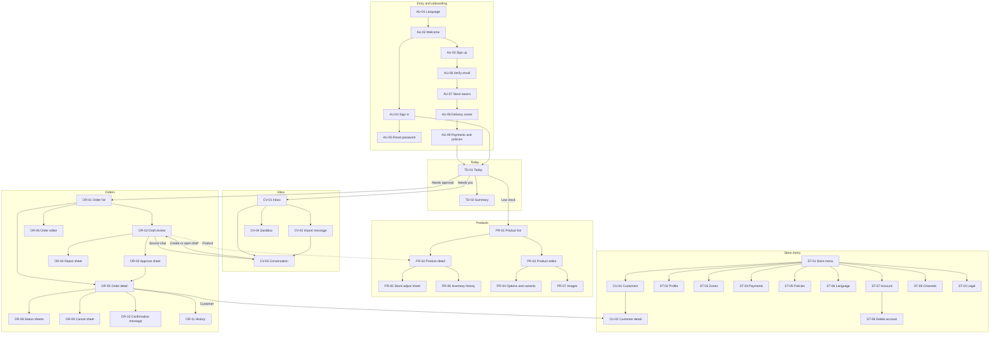
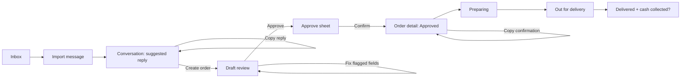

# 03 — Information architecture

**Phase 2, Deliverable 3** · Status: **Proposed — pending owner approval**
Basis: Phase 1 scope (§3), journeys (§7) and Today view (Journey G). No screens are added beyond P0 needs. Screen IDs are specified in [04](04-screen-specifications.md).

---

## 1. Primary navigation

**Four persistent destinations**, in this order (mirrored in RTL):

| # | Destination | Why it is persistent | Badge |
|---|---|---|---|
| 1 | **Today** (`House`) | Daily triage hub; default landing screen (Journey G) | none (Today *is* the summary) |
| 2 | **Inbox** (`ChatsCircle`) | Where sales start; used many times a day | Count of conversations in *Needs reply* + *Needs you* |
| 3 | **Orders** (`Receipt`) | Approval and fulfillment; used many times a day | Count of *Needs approval* orders |
| 4 | **Products** (`Package`) | Catalog and stock; used daily but less often | none (low-stock items appear on Today) |

**Deliberately not persistent:**
- **Customers:** reached from orders, conversations and the store menu. Sellers think in orders and chats, not customer records (Phase 1 personas).
- **Settings:** set up once, changed rarely. Available from the **store menu**.
- **Sandbox:** a learning tool, not a daily destination. Available from the Inbox overflow menu and the onboarding checklist.

**Store menu.** Each top-level screen's app bar carries a 40 px store button (logo or initials) at the trailing edge (start edge in RTL). It opens the Store menu screen with: Customers, Store profile, Delivery zones, Payments, Policies, Messaging channels, Language and display, Account, Help and feedback, Legal and licences, Sign out.

**Badges** are numbers with a text alternative for screen readers ("Orders, 3 need approval"). They are capped at "99+". No red dots without numbers.

### 1.1 Adaptive navigation
| Window class | Primary navigation |
|---|---|
| Compact | Bottom bar, 64 dp high, labels always shown |
| Medium / Expanded / Large | Navigation rail (72 dp) with labels; the store button sits at the top of the rail |

The bottom bar is hidden while a full-screen modal (editor, import) is open and while the keyboard is open.

---

## 2. Screen map

Shared pickers (sheets): **CU-03 Customer picker** (used by CV-02, OR-06) and **OR-07 Product and variant picker** (used by OR-02, OR-06). Global states: **GL-01 to GL-08** ([04 §11](04-screen-specifications.md#11-global-states)).

---

## 3. Navigation behaviour

### 3.1 Stacks and back
- **Each primary destination keeps its own navigation stack.** Switching tabs preserves where the seller was. Re-selecting the active tab pops to its root; selecting it again at the root scrolls to the top.
- **Back** (Android system back, the iOS edge swipe, or the app-bar back button) pops the current stack.
  - At the root of Inbox, Orders or Products, back goes to Today.
  - At Today, back leaves the app (no "press again to exit" prompt).
- **Android predictive back** and the **iOS edge-swipe** must both be supported. Neither may be blocked except by an unsaved-changes guard (§3.5).
- Back after a successful approval returns to the *list the seller came from*. The approved order shows in place with its new status; the seller is not dumped on another screen.

### 3.2 Moving between related records
| From | To | Behaviour |
|---|---|---|
| Today item (for example "3 need approval") | Owning list (Orders filtered to *Needs approval*) | **Switches tab** and applies the filter; the filter chip shows it clearly and can be cleared |
| Record to related record (order → customer, draft → source conversation, conversation → draft, order line → product) | Related record | **Pushes onto the current tab's stack** (does not switch tabs), so back returns to the origin |
| A related record that is a draft being reviewed | — | Opens OR-02 regardless of origin |

To prevent endless stacks, pushing a record already in the stack pops back to it instead of pushing a duplicate.

### 3.3 Modal surfaces: which one to use

| Surface | Use for | Examples | Not for |
|---|---|---|---|
| **Full-screen modal** (slides up, close ✕, explicit Save) | Creating or editing a multi-field record | Product editor, new order, import message, policy editor | Single-field edits |
| **Bottom sheet** (modal, drag handle, dismissible) | One focused decision or short form of ≤ 5 inputs | Stock adjustment, reject, cancel, status updates, pickers, approval confirmation, field edits on a draft | Long forms, anything needing the keyboard plus more than 2 fields on small phones (use full-screen) |
| **Dialog** (centred) | Destructive confirmation, unsaved changes, blocking errors | Discard changes, delete product image, sign out | Information that could be inline; success messages |
| **Snackbar** (bottom, level 2) | Confirmation of a completed, *non-critical* action, with optional Undo | "Stock updated", "Reply copied" | Errors that need action (use an inline banner), approval success (shown in place) |
| **Inline banner** | Persistent state of the current screen | Offline, AI unavailable, verify email, draft notice | Transient confirmations |

On tablets (expanded and up), bottom sheets with forms are presented as **centred dialogs** (max width 560). Pickers become **anchored side sheets** in the detail pane.

### 3.4 Search and filtering entry points
- Inbox, Orders, Products and Customers each have a **search field pinned under the title**. It collapses into a search icon on compact-small screens.
- Status filters are a **horizontal chip row** under the search field (single-select status groups). Extra filters (Products: category, low stock, archived) live in a filter sheet behind a `FunnelSimple` button that shows the active-filter count.
- There is **no global search in P0** (P1 candidate). Search is scoped to the current list and says so in its placeholder ("Search orders by number, name or phone").

### 3.5 Unsaved changes
- Full-screen editors track a *dirty* state. Back, swipe-back or close on a dirty editor shows the **Discard changes?** dialog. "Keep editing" is the default button; "Discard" is shown in danger style.
- **Draft review (OR-02) has no page-level unsaved state:** every field edit is made in a sheet with its own Save, and is persisted immediately (Phase 1 Journey E "Save and approve later").
- If the app is backgrounded, editor contents are kept in memory. If the OS kills the app, unsaved form data may be lost. That is acceptable in P0 and stated in the risks ([10](10-phase-2-report.md)). Store setup steps persist per step (Phase 1 US-008).

### 3.6 Deep links and notifications (route design for P0; push notifications are P1)
- Routes are entity-addressable: `/today`, `/inbox/{conversationId}`, `/orders/{orderId}`, `/products/{productId}`, `/customers/{customerId}`, `/store/...`.
- A link opens **inside its owning tab**, with that tab's root beneath it, so back works.
- When the user is signed out, the app goes to sign-in and continues to the target afterwards.
- When the record no longer exists, the user sees GL-04 "This order isn't available".
- When the record belongs to another store or access is denied, the user sees GL-03 "You don't have access". The screen reveals nothing about the record.

### 3.7 Permission and verification states
- P0 has one role (owner, D-03), so permission-denied is mainly a *server* response: a 403 shows GL-03; an expired session shows GL-02 (sign-in sheet, then return).
- **Unverified email** (Phase 1 Journey A step 4): the seller can set up the store and catalog, but **Approve** is disabled with the inline reason "Verify your email to approve orders" and a Resend link. Today shows a persistent info banner.
- Future staff roles (P1): actions the user cannot perform are **hidden** when irrelevant to their job, and **disabled with a reason** when the user would reasonably expect them (for example Approve: "Only the owner can approve orders").

---

## 4. Key navigation flows

### 4.1 Message to delivered order (Stage A, manual import)

### 4.2 Daily triage
`Today` → *Needs approval (n)* → Orders filtered → OR-02 → approve → back to the filtered list (count decreases) → back to Today.

### 4.3 First run
`AU-01 Language` → `AU-02 Welcome` → `AU-03 Sign up` → `AU-06 Verify (can continue)` → `AU-07` → `AU-08` → `AU-09` → `TD-01 Today` with the setup checklist (add product, try the sandbox, import a real message).

### 4.4 Stock problem at approval
`OR-03 Approve sheet` → server rejects (insufficient stock) → the sheet closes; OR-02 shows the danger banner listing the short lines → the seller edits a line or opens the product's stock sheet (PR-05) from the line → returns → approves.
