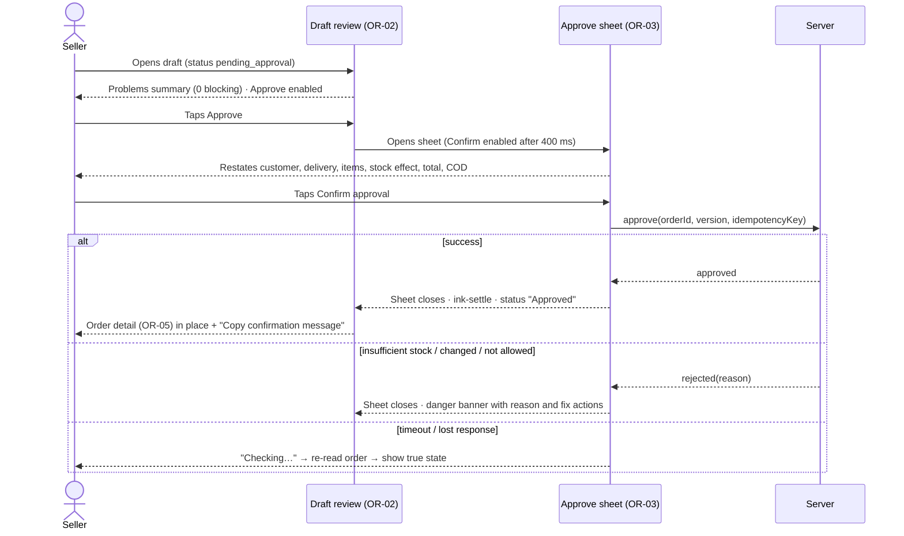

# 04 — Screen-by-screen specifications

**Phase 2, Deliverable 4** · Status: **Proposed — pending owner approval**
Depends on: [02 Tokens](02-visual-identity-and-tokens.md) · [03 IA](03-information-architecture.md) · [05 Components](05-components.md) · [06 Motion](06-motion.md) · [07 Localization and accessibility](07-localization-and-accessibility.md)

> **Sample data.** Every name, phone number, price, stock value and order number in this document is fictional sample data for design review only.

**Contents**
- §1 Shared state patterns
- §2 Screen inventory
- §3 Onboarding and authentication
- §4 Today
- §5 The order approval experience
- §6 Orders
- §7 Conversations and AI
- §8 Products and inventory
- §9 Customers
- §10 Settings and store menu
- §11 Global states

Each screen block follows the same 19-item template:

| # | Item |
|---|---|
| 1 | ID and name |
| 2 | Objective |
| 3 | Role and permissions |
| 4 | Entry points |
| 5 | Layout and hierarchy |
| 6 | Components |
| 7 | Primary action |
| 8 | Secondary actions |
| 9 | Data |
| 10 | Validation |
| 11 | Loading |
| 12 | Empty |
| 13 | Error |
| 14 | Success |
| 15 | Offline and retry |
| 16 | Accessibility |
| 17 | RTL and localization |
| 18 | Motion |
| 19 | Acceptance |

Where a screen uses a shared pattern from §1, the block names the pattern instead of repeating it.

---

## 1. Shared state patterns

| ID | Pattern | Specification |
|---|---|---|
| **P-LOAD-LIST** | List loading | Skeleton rows that match the real row layout (thumbnail block, 2 text bars, end-aligned number bar), enough to fill the viewport. Shown only if loading takes > 300 ms, to avoid a flash. Static `bg.sunken` blocks with one slow opacity pulse (1.0 ↔ 0.6, 1600 ms); static under reduced motion. Never more than one skeleton pattern per screen. |
| **P-LOAD-DETAIL** | Detail loading | Title bar with real title if known (for example "Order #1042" from the list), then skeleton section labels and row groups. Actions are hidden until loaded. |
| **P-LOAD-ACTION** | Action in progress | The pressed button shows an inline 16 px spinner **plus a progress label** ("Approving…", "Saving…"). Its width stays fixed and it is disabled. Other inputs in the same form are read-only; Back remains available unless the action is critical (approve, cancel, return), in which case dismissing is blocked until the outcome is known. After 10 s: "Still working…". After a timeout: P-ERR-UNKNOWN. |
| **P-EMPTY** | First-use empty | 64 px `bg.sunken` circle with a 24 px icon, a `heading` title, one sentence of `body` in `text.secondary`, one primary or secondary button. Vertically placed at about 30% of the space, not centred in a void. |
| **P-EMPTY-FILTER** | No results | "No results for '{query}'" or "No orders match these filters", with a **Clear filters** button. Never the first-use empty state. |
| **P-ERR-LOAD** | Load failed | Replaces content: a `WarningCircle` icon, "Couldn't load {thing}", a cause line (offline: "You're offline"; server: "Something went wrong on our side"), **Retry** (secondary), and an error-reference caption ("Ref: 7F3K-21") for support. |
| **P-ERR-ACTION** | Action failed | Inline danger banner at the top of the form or sheet: what failed, why (when known) and **Retry**. Input is preserved; the sheet stays open; field errors are shown on their fields. **Never a success snackbar.** |
| **P-ERR-UNKNOWN** | Outcome unknown (timeout or lost response on a critical write) | The action button shows "Checking…". The client re-reads the record. If the change happened, show success; if not, show P-ERR-ACTION with "Not approved — try again". The user never sees an optimistic success. |
| **P-OFFLINE** | No connectivity | GL-01 banner under the app bar. Lists keep showing data already loaded in this session with "Last updated {time}". Write actions stay visible but disabled, with the reason "You're offline". Reads retry automatically on reconnect; writes are never retried automatically. |
| **P-SUCCESS-INPLACE** | Success | The changed record updates in place (status badge, stock number), using the motion in [06](06-motion.md). Minor actions also show a snackbar (4 s; with Undo only where the undo is real and safe). |
| **P-A11Y-BASE** | Baseline accessibility | All baseline requirements in [07 §5](07-localization-and-accessibility.md#5-accessibility-requirements). Each screen block lists only screen-specific additions. |
| **P-RTL-BASE** | Baseline RTL | All baseline rules in [07 §2](07-localization-and-accessibility.md#2-rtl-layout-rules). Each screen block lists only screen-specific notes. |

---

## 2. Screen inventory

| ID | Screen | Group | Priority | Presentation |
|---|---|---|---|---|
| AU-01 | Language selection | Onboarding | P0 | Full screen (first launch only) |
| AU-02 | Welcome | Onboarding | P0 | Full screen |
| AU-03 | Sign up | Auth | P0 | Full screen |
| AU-04 | Sign in | Auth | P0 | Full screen |
| AU-05 | Reset password | Auth | P0 | Full screen |
| AU-06 | Verify email | Auth | P0 | Full screen + persistent banner |
| AU-07 | Store setup 1/3: Store basics | Onboarding | P0 | Full screen (stepper) |
| AU-08 | Store setup 2/3: Delivery zones | Onboarding | P0 | Full screen (stepper) |
| AU-09 | Store setup 3/3: Payments and policies | Onboarding | P0 | Full screen (stepper) |
| TD-01 | Today | Overview | P0 | Tab root |
| TD-02 | Summary | Overview | P0 (minimal) | Pushed |
| OR-01 | Order list | Orders | P0 | Tab root |
| OR-02 | Draft review | Orders | P0 | Pushed |
| OR-03 | Approve order (confirmation) | Orders | P0 | Bottom sheet |
| OR-04 | Reject draft | Orders | P0 | Bottom sheet |
| OR-05 | Order detail | Orders | P0 | Pushed |
| OR-06 | Order editor (new / edit before dispatch) | Orders | P0 | Full-screen modal |
| OR-07 | Product and variant picker | Shared | P0 | Bottom sheet (full height) |
| OR-08 | Status update sheets | Orders | P0 | Bottom sheets |
| OR-09 | Cancel order | Orders | P0 | Bottom sheet |
| OR-10 | Confirmation message | Orders | P0 | Bottom sheet |
| OR-11 | Order history | Orders | P0 | Pushed |
| CV-01 | Inbox | Conversations | P0 | Tab root |
| CV-02 | Import message | Conversations | P0 | Full-screen modal |
| CV-03 | Conversation | Conversations | P0 | Pushed |
| CV-04 | Sandbox conversation | Conversations | P0 | Pushed (variant of CV-03) |
| PR-01 | Product list | Products | P0 | Tab root |
| PR-02 | Product detail | Products | P0 | Pushed |
| PR-03 | Product editor | Products | P0 | Full-screen modal |
| PR-04 | Options and variants | Products | P0 | Pushed within editor |
| PR-05 | Adjust stock | Products | P0 | Bottom sheet |
| PR-06 | Inventory history | Products | P0 | Pushed |
| PR-07 | Image manager | Products | P0 | Pushed within editor / viewer |
| CU-01 | Customer list | Customers | P0 | Pushed from store menu |
| CU-02 | Customer detail | Customers | P0 | Pushed |
| CU-03 | Customer picker | Shared | P0 | Bottom sheet |
| ST-01 | Store menu | Settings | P0 | Pushed |
| ST-02 | Store profile | Settings | P0 | Pushed |
| ST-03 | Delivery zones | Settings | P0 | Pushed + zone sheet |
| ST-04 | Payments | Settings | P0 | Pushed |
| ST-05 | Policies | Settings | P0 | Pushed + editor modal |
| ST-06 | Language and display | Settings | P0 | Pushed |
| ST-07 | Account | Settings | P0 | Pushed |
| ST-08 | Delete account | Settings | P0 | Pushed flow |
| ST-09 | Messaging channels | Settings | P0 (honest "none connected"); connect flow P1 | Pushed |
| ST-10 | Legal and licences | Settings | P0 | Pushed |
| GL-01…08 | Global states | All | P0 | Banners / full-screen states / dialogs |

**Future (not designed in detail; must reuse these patterns):**
- P1: staff management, channel connection flow, push-notification settings, reports, bulk import, Arabic UI.
- P2: billing.

---

## 3. Onboarding and authentication

### AU-01 Language selection
| # | Spec |
|---|---|
| 2 | Choose the app language before anything else. |
| 3 | Unauthenticated. |
| 4 | First launch only (later changes happen in ST-06). |
| 5 | Brand mark at the top (40 px); title "Choose your language" shown **bilingually** (Sorani line, then English line); two large selection rows: **کوردی (سۆرانی)** and **English**, each 64 dp high with a radio indicator; **Continue** in the sticky bottom bar. |
| 6 | `SelectionRow` ×2, `Button.primary` |
| 7 | Continue (enabled once a language is selected; pre-selected from the device locale if it is ckb or en). |
| 8 | — |
| 9 | Device locale. |
| 10 | — |
| 11–13 | None (local screen). |
| 14 | Layout direction switches **immediately** on selection (preview of RTL/LTR) before Continue. |
| 15 | Works offline. |
| 16 | Each row has its language name as a semantics label in that language; a radio group with a selected state. |
| 17 | Each row renders in its own script and direction regardless of the current UI direction. |
| 18 | Direction switch: 200 ms crossfade of the whole screen (no sliding, which would be confusing when direction flips). |
| 19 | Selecting Sorani flips the screen to RTL immediately; the choice persists after restart; the screen never reappears once chosen. |

### AU-02 Welcome
| # | Spec |
|---|---|
| 2 | Explain the value in 10 seconds, then choose Sign up or Sign in. |
| 3 | Unauthenticated. |
| 4 | After AU-01; after sign-out. |
| 5 | Up to 3 swipeable panels, skippable: (1) "Answers from your own catalog", (2) "You approve every order", (3) "Stock stays right". Each panel shows a **real UI fragment** (a pencil-style suggestion, an approve button, a stock number), not an illustration. Page indicator. Bottom: **Create account** (primary), **I have an account** (secondary). |
| 6 | `Pager`, `PageIndicator`, `Button.primary`, `Button.secondary` |
| 7 | Create account |
| 8 | Sign in; Skip (jumps to the last panel). |
| 9–13 | — |
| 14 | — |
| 15 | Offline: buttons stay enabled; the next screen handles offline. |
| 16 | Panels are readable by a screen reader as a list; auto-advance is **never** used. |
| 17 | Swipe direction follows the reading direction (next panel enters from the left in RTL). |
| 18 | Panels: horizontal shared-axis 260 ms; fragments fade and rise 8 dp, 200 ms. Reduced motion: crossfade. |
| 19 | Both CTAs reachable without swiping; copy contains no claim of live channel connection. |

### AU-03 Sign up
| # | Spec |
|---|---|
| 2 | Create an account. |
| 3 | Unauthenticated. |
| 4 | AU-02. |
| 5 | Title "Create your account"; fields: Email, Password (show/hide toggle, strength hint "At least 8 characters"); terms consent text with links (Terms, Privacy); **Create account** sticky; "Already have an account? Sign in". |
| 6 | `TextField.email`, `TextField.password`, `InlineLink`, `Button.primary` |
| 7 | Create account |
| 8 | Sign in link; open Terms or Privacy (in-app viewer). |
| 9 | — |
| 10 | Email format; password ≥ 8; validated on submit, then live per field after the first submit. |
| 11 | P-LOAD-ACTION ("Creating account…"). |
| 12 | — |
| 13 | Email exists: field-level message with actions **Sign in** and **Reset password** (Phase 1 US-001). Rate-limited: banner "Too many attempts. Try again in {n} minutes." Other: P-ERR-ACTION. |
| 14 | Navigates to AU-06. |
| 15 | P-OFFLINE: the button is disabled with the reason. |
| 16 | Autofill hints (email, new password); the password toggle has the label "Show password"; errors are announced. |
| 17 | Email and password fields are **always LTR** (left-aligned in RTL), with labels in UI direction. |
| 18 | Standard push. Error banner: slide down 8 dp and fade in, 160 ms. |
| 19 | No duplicate accounts on double-tap; entered email is preserved on error; no success shown before the server confirms. |

### AU-04 Sign in
Same structure as AU-03.
- Title "Welcome back"; fields Email and Password; **Sign in**; "Forgot password?" link.
- Error: a single generic message, "Email or password is incorrect" (no enumeration).
- Success: go to the deep-link target, otherwise Today (or the first incomplete setup step, Phase 1 US-008).
- Acceptance: a session persists across restarts (US-002).

### AU-05 Reset password
| # | Spec |
|---|---|
| 2 | Request a reset link. |
| 5 | Email field, **Send reset link**. After sending, the screen shows "If an account exists for {email}, we've sent a link" with a Resend button (60 s cooldown counter) and Back to sign in. |
| 13 | Identical response whether the account exists or not (US-003). |
| 18 | Form to confirmation: crossfade 200 ms. |
| 19 | The cooldown is visible and announced; no enumeration. |

### AU-06 Verify email
| # | Spec |
|---|---|
| 2 | Tell the seller to verify, without blocking setup. |
| 5 | Icon, "Check your inbox", the email address, **Continue setup** (primary), Resend (60 s cooldown), "Wrong email? Change it". |
| 14 | When verification is detected (on app resume), the banner on Today disappears with a snackbar "Email verified". |
| 19 | The seller can continue setup unverified; Approve remains disabled with a reason until verified ([03 §3.7](03-information-architecture.md#37-permission-and-verification-states)). |

### AU-07 / AU-08 / AU-09 Store setup (3-step stepper)
Shared frame: app bar with step indicator "Step 1 of 3" and a linear progress bar; content max width 560; sticky **Continue**. Back goes to the previous step. Each step **persists on Continue**, so the seller resumes at the first incomplete step (US-008).

| # | AU-07 Store basics | AU-08 Delivery zones | AU-09 Payments and policies |
|---|---|---|---|
| 2 | Create the store | Define where the seller delivers and for how much | Confirm COD; capture the seller's policy answers |
| 5 | Store name; contact phone; currency (segmented: **IQD** / USD, with the helper "Can't be changed after your first approved order"); **customer reply language** (Sorani / English); business city (picker) | Suggested zones as toggle rows (Sulaymaniyah, Erbil, Duhok, Halabja) plus "Add another area". Each enabled zone expands inline: fee (numeric, currency suffix), optional delivery-time text | Payment: COD switch (on); "Other (record only)" switch. Policies: 4 optional prompts (Exchange and returns, Authenticity, Working hours, Anything customers often ask), each opening the policy editor. Helper: "Aisellia only uses what you write here." |
| 7 | Continue (creates the store) | Continue | **Finish setup** |
| 8 | — | **Skip for now** (Phase 1 Journey A; the checklist will flag it) | Skip policies |
| 10 | Name 1–60 characters; valid phone (normalised, Iraqi format hint); currency required | Fee integer ≥ 0 (Eastern digits accepted); unique zone names | — |
| 11 | P-LOAD-ACTION | P-LOAD-ACTION | P-LOAD-ACTION |
| 13 | P-ERR-ACTION; idempotent retry (no duplicate store) | P-ERR-ACTION | P-ERR-ACTION |
| 14 | Next step | Next step | TD-01 with the checklist; snackbar "Your store is ready" |
| 15 | P-OFFLINE (disabled with reason) | same | same |
| 16 | Stepper progress is announced ("Step 2 of 3") | Fee fields are labelled with the zone name ("Fee for Erbil") | — |
| 17 | Phone LTR | Fees are LTR numbers, end-aligned; currency unit localized | — |
| 18 | Steps: shared-axis horizontal 260 ms; the progress bar animates 240 ms | Zone expansion: size and fade 200 ms | — |
| 19 | Restart mid-setup resumes correctly | Skipping zones leaves an AI and checklist warning | Finish leads to Today; nothing claims a channel connection |

---

## 4. Today

### TD-01 Today
```
┌──────────────────────────────────────┐
│ Today                          [◉ S] │  title.large + store button
│ Thursday, 15 October                 │  caption
├──────────────────────────────────────┤
│ ⓘ Verify your email to approve orders│  banner (only if unverified)
│ SET UP YOUR STORE         2 of 5 done│  checklist (until dismissed)
│  ✓ Store details                     │
│  ○ Add your first product          › │
│  ○ Try a sandbox conversation      › │
│ NEEDS ATTENTION                      │
│  ✎ Needs approval               3  › │  rows hidden when 0
│  ⚑ Needs you                    1  › │
│  ✎ Drafts missing details       2  › │
│  ▢ To prepare or dispatch       4  › │
│  ⚠ Delivery problems            1  › │
│  ¤ Cash to collect     420,000 IQD › │
│  ↘ Low or out of stock          5  › │
│ TODAY SO FAR                         │
│  Approved  6 · Delivered  4          │
│  Value approved        455,000 IQD   │
│  See summary                       › │
└──────────────────────────────────────┘
(sample data)
```
| # | Spec |
|---|---|
| 2 | Show exactly what needs the seller's attention now, and give one-tap access to each item (Phase 1 Journey G). |
| 3 | Owner. |
| 4 | App launch (default); the Today tab; back from tab roots. |
| 5 | Order: banners, then the setup checklist (if incomplete and not dismissed), then **Needs attention** (one row group, rows ordered by urgency as in Journey G), then **Today so far**. **No KPI cards, no charts.** Counts are end-aligned `numeric.body`; cash to collect shows an amount. Tablet (expanded): two columns. Start column: Needs attention. End column: Today so far plus the checklist. |
| 6 | `Banner`, `ChecklistGroup`, `AttentionRow`, `SummaryRow`, `StoreButton` |
| 7 | Tap an attention row → the owning list with the filter applied ([03 §3.2](03-information-architecture.md#32-moving-between-related-records)). |
| 8 | Checklist items; See summary; pull-to-refresh. |
| 9 | Counts from persisted data (Phase 1 US-042), excluding test orders; date in the store's timezone. |
| 10 | — |
| 11 | P-LOAD-DETAIL with skeleton rows in the attention group (titles visible, counts skeletonised). |
| 12 | **All caught up:** when every attention count is 0, the group is replaced by a single calm row: `CheckCircle` "All caught up. New drafts and messages will appear here." **Empty store** (no products): the checklist is expanded and "Add your first product" is highlighted; "Today so far" is hidden. |
| 13 | P-ERR-LOAD. **Never show zeros on failure** (zeros would read as "nothing to do"). |
| 14 | Counts update when returning from other tabs (refetch on focus). A count change animates (number roll, [06 §4](06-motion.md#4-business-status-changes)). |
| 15 | P-OFFLINE: shows last-loaded counts with "Last updated {time}"; attention rows remain tappable (they show whatever was loaded). |
| 16 | Each row reads "Needs approval, 3 orders, button". The summary amount reads with its currency. |
| 17 | Row chevrons mirror; counts sit at the end (left in RTL); amounts stay LTR-isolated. The date is localized ([07 §3](07-localization-and-accessibility.md#3-numbers-currency-dates)). |
| 18 | First load: sections fade in staggered 40 ms each (max 4 steps). Afterwards no entrance animation on revisit. A row that becomes 0 collapses (200 ms). |
| 19 | Counts reconcile with the filtered lists they open; nothing is shown that is not backed by data; the all-caught-up and error states are distinguishable. |

### TD-02 Summary
| # | Spec |
|---|---|
| 2 | Simple, reconciled period totals (Phase 1 US-043). |
| 5 | Segmented period control: Today / 7 days / This month. One row group: Approved orders (count), Approved value, Delivered (count), Cash to collect (amount). Each row links to the matching filtered order list. Footnote "Excludes test, rejected, cancelled and returned orders." **No charts in P0.** |
| 11 | Skeleton rows. |
| 12 | Period with no orders: rows show 0 and a note "No approved orders in this period". 0 is a real value here, unlike an error. |
| 13 | P-ERR-LOAD. |
| 16 | The segmented control is announced as tabs. |
| 18 | Period change: values crossfade (160 ms); no number roll for whole-table swaps. |
| 19 | Every figure equals the count or sum of the list it links to. |

---

## 5. The order approval experience

This is the most critical interaction in Aisellia. It applies Phase 1 BR-01–05, BR-21–25, BR-30–36 and Journey E. **A visual interaction is never treated as authorization: the server enforces every rule.**

### 5.1 Principles
1. **A draft never looks like an order.** Drafts always carry the pencil treatment and the text "Draft — not confirmed". Signature Blue fill never appears on a draft except the Approve button.
2. **Everything that will be committed is visible before approval.** The seller never approves something they have not been shown.
3. **Problems come first.** Blocking issues are summarised at the top, and each is linked to its field.
4. **AI suggestions are distinguishable from verified data**, field by field (provenance).
5. **Two deliberate steps** to approve: the Approve button, then a confirmation sheet that restates what will happen.
6. **No optimistic success.** "Approved" appears only after the server confirms.

### 5.2 Field provenance presentation (Phase 1 §8.6)

| Provenance | Value style | Caption (icon + text) | Blocks approval? |
|---|---|---|---|
| From customer | Value with a 1.5 px **dotted pencil underline** | `ChatText` "From customer". Tapping shows the source excerpt sheet with the quoted message and its time. | No |
| From catalog | Ink (plain) | `BookOpen` "Catalog price" / "From catalog" | No |
| From your settings | Ink | `Gear` "From your settings" | No |
| Inferred — check | Value inside a **warning-outlined dotted box** | `Question` "Inferred — confirm" + inline **Confirm** button | **Yes for quantity**, no for other fields (warning only) |
| Conflict — choose | Danger outline; both values listed | `WarningCircle` "Customer gave 2 numbers — choose one" | Yes |
| Missing (required) | Placeholder "Add {field}" in danger text, with an add button | `WarningCircle` "Required" | Yes |
| Missing (optional) | "— Not provided (optional)" in `text.tertiary` | none | No |
| Edited by you | Ink | `UserCircle` "Edited by you" | No |

### 5.3 What must be visible before approval

| Information | Where | Correction required when |
|---|---|---|
| Draft status and source (AI or manual; channel; link to the conversation) | Draft banner | — |
| Customer name, phone(s) | Customer section | Missing name; missing or invalid phone; phone conflict |
| City or zone, area, landmark, delivery fee | Delivery section | Missing city or zone; zone not configured (seller must choose a fee); missing area |
| Each line: product name, variant, image, quantity, unit price, line total, **current stock** | Items section | Unresolved product ("Choose product"), unresolved variant, out of stock or insufficient, archived or inactive product, inferred quantity unconfirmed |
| Price changed since the quote (BR-23) | On the line: "Catalog price changed: 35,000 → 38,000" with a choice | Seller must choose before approval |
| Subtotal, delivery fee, discount (owner), **Total**, payment method, **COD amount** | Totals section | Payment method missing |
| Seller notes, customer note | Notes section | — |
| Stock effect | Confirmation sheet (OR-03) | — |

### 5.4 Interaction sequence



### 5.5 Protections against accidental approval
- Approve sits in the sticky action bar at the **end** position. Reject sits at the start position and is visually distinct (danger-outline). They are never adjacent primary-looking buttons.
- Approve is **disabled while any blocking issue exists**, with a reason line above the buttons naming the first issue ("Confirm the quantity to enable approval"). Tapping the disabled button scrolls to the first issue and focuses it.
- The confirmation sheet's **Confirm** button is placed in a different vertical position from the Approve button (top of the sheet's action area, below the summary), so a double tap cannot pass through. It ignores input for 400 ms after the sheet is presented.
- Every approval request carries the order version and an idempotency key (Phase 1 BR-22). A repeated tap shows the existing outcome.
- Unverified email: Approve is disabled with "Verify your email to approve orders".
- A **test order** shows the outlined "Test" badge in the banner and on the button label ("Approve test order").

### 5.6 Rejection, cancellation and errors
- **Reject** (OR-04): a reason is required (preset chips: Customer changed mind, Duplicate, Spam / not a real order, Wrong details, Other plus text); the button is **Reject draft** in danger style. Success: status `Rejected`, a neutral badge, the order stays in history; snackbar "Draft rejected" with **no Undo** (rejection is terminal, BR-30).
- **Cancel** (OR-09, approved or processing only): reason required; the sheet states the stock effect ("2 items will return to stock") and offers a cancellation message to copy afterwards.
- **Approval errors:**

| Error | Presentation | Recovery |
|---|---|---|
| Insufficient stock | Danger banner: "Not approved — 1 item doesn't have enough stock". The affected line shows "Requested 2 · 1 in stock". | Line actions: Change quantity, Change size, Remove, **Adjust stock** (opens PR-05) |
| Order changed elsewhere | Info banner "This order was updated on another device", then reload | Review again |
| Already approved (duplicate) | Navigate to OR-05 showing Approved; no error tone | — |
| Price changed | Warning on the line with a choice | Choose a price |
| Network or unknown | P-ERR-UNKNOWN, then the true state | Retry is safe (idempotent) |
| Not allowed (server 403) | GL-03 inline: "You can't approve this order" | — |

### OR-02 Draft review
```
┌──────────────────────────────────────┐
│ ‹  Order #1042        Needs approval │
├──────────────────────────────────────┤
│ ┌╌╌╌╌╌╌╌╌╌╌╌╌╌╌╌╌╌╌╌╌╌╌╌╌╌╌╌╌╌╌╌╌╌╌┐ │
│ ╎ ✎ Draft — not confirmed          ╎ │ pencil banner
│ ╎ Prepared by Aisellia from an     ╎ │
│ ╎ imported Instagram chat. View ›  ╎ │
│ └╌╌╌╌╌╌╌╌╌╌╌╌╌╌╌╌╌╌╌╌╌╌╌╌╌╌╌╌╌╌╌╌╌╌┘ │
│ ⚠ 1 thing to check                 › │ issues summary
│ CUSTOMER                             │
│  Name      Nzar Ahmad               │
│            ┈┈┈┈┈┈┈┈┈ (chat) From cust.│
│  Phone     +964 750 123 4567        │
│ DELIVERY                             │
│  City      Erbil · Ankawa  (settings)│
│  Landmark  — Not provided (optional) │
│  Fee                       5,000 IQD │
│ ITEMS                     + Add item │
│  [img] Beige Abaya        35,000     │
│        Size M · 4 in stock           │
│        ⁝Qty 2 · Inferred⁝ [Confirm]  │
│ TOTAL                                │
│  Subtotal                 70,000 IQD │
│  Delivery                  5,000 IQD │
│  Total · Cash on delivery 75,000 IQD │
├──────────────────────────────────────┤
│ ⓘ Confirm the quantity to approve    │
│ [ Reject ]        [ Approve order  ] │ sticky action bar
└──────────────────────────────────────┘
(sample data; see artifacts/concept-board.png)
```
| # | Spec |
|---|---|
| 2 | Verify, correct and decide on a draft order. |
| 3 | Owner. Editing is allowed for drafts and pending orders. **Approve is owner only** (staff "Can approve" in P1). |
| 4 | Conversation "Create order" or draft chip; Orders list (Needs approval / Drafts); Today rows; deep link. |
| 5 | Top to bottom: draft banner (pencil), issues summary (warning or danger; each issue links to its field), Customer, Delivery, Items, Total, Notes, then the sticky action bar with the reason line. Each row is tappable and opens its **field edit sheet**. Expanded: the list pane stays visible. Large: a **third column shows the source conversation**, with the excerpts that fed each field highlighted when that field is focused. |
| 6 | `DraftBanner`, `IssueSummary`, `FieldRow` with `ProvenanceCaption`, `OrderLineRow` (with `StockIndicator`, `InferredValue`, `QuantityStepper` in the edit sheet), `PriceRow`, `StickyActionBar`, `Button.primary`, `Button.dangerOutline` |
| 7 | **Approve order** (→ OR-03). |
| 8 | Reject (→ OR-04); edit any field; Add item (→ OR-07); Confirm inferred value; View source conversation; overflow: Delete line, Set discount (owner), View history. |
| 9 | Draft order with provenance per field; live catalog price and stock per line; zone fee; totals computed by the server (BR-24). |
| 10 | Field sheets validate as in Phase 1 BR-36/37 and 8.7: phone normalisation; quantity 1–999 (soft warning > 20); discount ≤ subtotal. The status re-evaluates after each save (draft ↔ pending_approval). |
| 11 | P-LOAD-DETAIL. Field sheet saves use P-LOAD-ACTION in the sheet. |
| 12 | A draft with no items shows the Items section as "No items yet" with **Add item** (blocking). |
| 13 | Load: P-ERR-LOAD. Field save: P-ERR-ACTION in the sheet. Approval errors: §5.6. |
| 14 | Field saved: the value updates in place; provenance becomes "Edited by you"; the issue count animates down. Approval: §5.4, followed by OR-05. |
| 15 | P-OFFLINE: everything is read-only; Approve and Reject are disabled with "You're offline". |
| 16 | The issues summary is announced first on open (polite live region): "Draft order 1042, 1 thing to check". Each field's semantics label includes its provenance ("Name, Nzar Ahmad, from customer"). The disabled Approve button exposes its reason as a hint. Focus order: banner, issues, sections, action bar. |
| 17 | Label and value rows mirror; the dotted underline follows the text run direction; product names in Latin are isolated; prices and phones stay LTR; Reject sits at the start edge (right in RTL) and Approve at the end edge (left in RTL). |
| 18 | Issue resolved: its row collapses (200 ms) and the counter rolls. On approval success: **ink settle** ([06 §4](06-motion.md#4-business-status-changes)). Errors: banner slides in from the top (160 ms). |
| 19 | (a) A draft can never show "Approved" styling. (b) Approve is impossible while a blocking issue exists (UI **and** server). (c) Every committed value is visible before approval. (d) AI-provided fields show provenance. (e) Error states never imply success. (f) Works in both directions at 200% text scale. |

### OR-03 Approve order (confirmation sheet)
| # | Spec |
|---|---|
| 2 | Last explicit check before committing. |
| 5 | Title "Approve order #1042?". Compact summary: customer name and phone; delivery (zone, area); items as "2 × Beige Abaya · M"; **Stock after approval** list ("Beige Abaya · M: 4 → 2"); Total and COD amount (`numeric.total`). Statement: "Approving confirms this order and removes these items from stock. The customer is **not** messaged automatically." Buttons: **Confirm approval** (primary, full width), Back (text). |
| 7 | Confirm approval (ignores input for the first 400 ms after presentation). |
| 11 | P-LOAD-ACTION ("Approving…"); dismissal blocked while in flight. |
| 13 | §5.6; P-ERR-UNKNOWN. |
| 14 | The sheet closes, then the ink settle on the underlying screen. |
| 15 | Cannot be opened offline. |
| 16 | The sheet title is focused on open; the statement is read before the button. |
| 18 | Sheet enter 280 ms (`ease.enter`); exit 200 ms. |
| 19 | The stock change shown equals the movement the server records; double-confirm creates one approval. |

### OR-04 Reject draft (sheet)
Reason chips (single select) plus an optional text field (required for "Other"), and **Reject draft** in danger style.
- Success: status Rejected; snackbar "Draft rejected".
- Error: P-ERR-ACTION.
- Acceptance: no stock change; rejected orders appear under the "Closed" filter.

---

## 6. Orders

### OR-01 Order list
| # | Spec |
|---|---|
| 2 | Find and triage orders by state. |
| 3 | Owner. |
| 4 | Orders tab; Today rows (pre-filtered). |
| 5 | Title.large "Orders", then a pinned search field, then a status chip row: **Needs approval · Drafts · Active · Delivered · Problems · Closed · Test**. Then a virtualised list of `OrderRow`s grouped by day ("Today", "Yesterday", date). FAB: **New order**. Expanded: list–detail. |
| 6 | `SearchField`, `FilterChipRow`, `OrderRow`, `SectionHeader`, `Fab.extended` |
| 7 | Open an order: drafts and pending orders open OR-02; others open OR-05. |
| 8 | New order (OR-06); search; filters; pull-to-refresh. |
| 9 | `OrderRow`: order number, status badge, customer name, item summary ("2 × Beige Abaya +1"), total (end, tabular), relative time; COD outstanding icon when applicable. |
| 10 | Search normalises Eastern digits and phone formats (US-039). |
| 11 | P-LOAD-LIST. Pagination: next page loads at 80% scroll with a footer spinner. |
| 12 | First use: icon `Receipt`, "No orders yet", "Orders appear here when you create one or when Aisellia drafts one from a conversation." Buttons: New order; Import a message. With a filter: P-EMPTY-FILTER. |
| 13 | P-ERR-LOAD; a pagination error shows an inline footer Retry. |
| 14 | Returning from an approval shows the row updated in place (status badge crossfade). |
| 15 | P-OFFLINE. |
| 16 | Each row reads as one sentence: "Order 1042, needs approval, Nzar Ahmad, 2 Beige Abaya, 75,000 dinars, 10 minutes ago". |
| 17 | Totals at the end edge; status badge after the order number in reading order. |
| 18 | Filter change: list crossfade 160 ms (no slide). |
| 19 | Filter counts match Today; large lists scroll smoothly (virtualised); test orders appear only under Test. |

### OR-05 Order detail (approved through terminal)
```
┌──────────────────────────────────────┐
│ ‹  Order #1042         ✓ Approved  ⋯ │
├──────────────────────────────────────┤
│ ●━━━━━━○━━━━━━━○━━━━━━━○             │ progress: Approved → Preparing
│ Approved Preparing  Out for  Delivered│           → Out for delivery → Delivered
│ Copy confirmation message          › │
│ CUSTOMER · DELIVERY · ITEMS · TOTAL  │ (same rows as review, ink only)
│ PAYMENT                              │
│  Cash on delivery due     75,000 IQD │
│  Collected                         — │
│ HISTORY                              │
│  Approved by you · 10:42             │
│  See full history                  › │
├──────────────────────────────────────┤
│ [        Mark as preparing         ] │ next-step action
└──────────────────────────────────────┘
```
| # | Spec |
|---|---|
| 2 | See the committed order and move it to its next state. |
| 3 | Owner (staff can update fulfilment in P1). |
| 4 | OR-01; after approval; Today rows; customer detail. |
| 5 | App bar with the status badge and overflow. A progress tracker (4 steps; shows a branch state for Delivery failed / Returned / Cancelled). Copy confirmation message row. Sections in ink (no provenance captions; the source is still viewable in history). Payment section; history preview. Sticky **next-step** action. |
| 6 | `StatusBadge`, `ProgressTracker`, `FieldRow`, `OrderLineRow` (read-only), `PriceRow`, `PaymentSummary`, `HistoryPreview`, `StickyActionBar` |
| 7 | Contextual next step: Approved → **Mark as preparing**; Preparing → **Mark out for delivery**; Out for delivery → **Mark delivered** (secondary: Delivery failed); Delivered with COD outstanding → **Record cash**; Delivery failed → **Try again** (secondary: Mark returned). Terminal states have no sticky bar. |
| 8 | Overflow: Edit order (approved or processing only; OR-06), Cancel order (approved or processing only; OR-09), Copy confirmation (OR-10), View conversation, View customer, Full history (OR-11). |
| 9 | Order, status events, payment record. |
| 10 | The transition sheets enforce Phase 1 BR-30 (for example dispatch requires complete delivery details). |
| 11 | P-LOAD-DETAIL. |
| 12 | — |
| 13 | P-ERR-LOAD; transition failures use P-ERR-ACTION inside the sheet. |
| 14 | Status change: badge crossfade plus the tracker step fills ([06 §4](06-motion.md#4-business-status-changes)); snackbar "Marked as out for delivery". |
| 15 | P-OFFLINE (transitions disabled). |
| 16 | The tracker is announced as "Step 2 of 4, Preparing"; branch states are announced by name. |
| 17 | The tracker runs right-to-left in RTL. |
| 18 | See [06 §4](06-motion.md#4-business-status-changes). |
| 19 | Only allowed transitions are offered; edit and cancel are hidden after dispatch; COD outstanding reconciles with the payment rows. |

### OR-06 Order editor (new manual order / edit before dispatch)
| # | Spec |
|---|---|
| 2 | Create a manual order or edit an approved one before dispatch (BR-31, BR-33). |
| 5 | Full-screen modal: Customer (picker CU-03 or new), Delivery (zone picker, area, landmark, fee pre-filled from the zone and editable by the owner), Items (OR-07 picker; quantity stepper per line; current stock shown), Discount (owner), Payment method, Notes. Sticky bar: **Save** (new order: "Save as draft" plus **Save and approve…** which goes through OR-03). In edit mode: **Save changes**, with a stock difference summary ("Stock: Beige Abaya · M −1"). |
| 10 | Same as OR-02. In edit mode, increases are checked against stock on save (server); failure shows per-line errors. |
| 11–15 | P-LOAD-ACTION / P-ERR-ACTION / P-OFFLINE. Dirty-state guard ([03 §3.5](03-information-architecture.md#35-unsaved-changes)). |
| 18 | Modal enters from the bottom (300 ms `ease.enter`). Line add: size and fade 200 ms. |
| 19 | No manual order bypasses the approval sheet; edit after dispatch is impossible; stock differences are applied once. |

### OR-07 Product and variant picker (sheet, full height)
Search field (autofocus) plus a list of **active** products with thumbnail, name, price and availability.
- Tapping a product with options shows a variant step (chips per option; unavailable variants disabled with "Out of stock").
- Quantity stepper; **Add to order**.
- Archived and inactive products are never listed. Out-of-stock variants are shown but disabled, with the reason.
- Empty catalog: "No products yet" + **Add product** (opens PR-03 over the sheet).

### OR-08 Status update sheets
| Sheet | Content | Primary |
|---|---|---|
| Mark as preparing | No inputs (no sheet; immediate action with P-LOAD-ACTION on the button) | — |
| Mark out for delivery | Optional courier or driver name, optional note; shows the delivery details for a final check | **Mark out for delivery** |
| Mark delivered | "Cash collected?" segmented: Yes, all (amount pre-filled) / Not yet / Partly (amount field) | **Mark delivered** |
| Delivery failed | Reason chips (Customer unreachable, Refused, Wrong address, Other plus text) | **Mark delivery failed** (warning style) |
| Mark returned | Per line: **Restock** or **Write off** (segmented, no default, so each line must be chosen); summary "3 items back to stock, 1 written off" | **Mark returned** |
| Record cash | Amount (≤ outstanding) | **Record cash** |

All sheets: P-LOAD-ACTION, P-ERR-ACTION, idempotent; success updates OR-05 in place with a snackbar.

### OR-09 Cancel order (sheet)
Reason required. The statement lists the restock effect. **Cancel order** in danger style; a secondary "Keep order" is the default focus.
- Success: Cancelled badge, then the offer "Copy cancellation message".
- Acceptance: restock happens exactly once; cancel is unavailable after dispatch (UI and server).

### OR-10 Confirmation message (sheet)
| # | Spec |
|---|---|
| 2 | Give the seller the post-approval confirmation text to send manually (Stage A). |
| 5 | Message preview in the reply language (editable text area): order number, items, total, delivery fee, COD amount. **Copy message** (primary). After copying: state "Copied — not confirmed as sent" and an **I sent this** button. |
| 9 | Only available for `approved` and later (BR-04). |
| 14 | "I sent this" records `marked_sent`; the order shows "Confirmation marked as sent by you". |
| 19 | Never labelled "Sent"; never offered for drafts. |

### OR-11 Order history
A chronological list of status events and edits: actor, time, from and to, reason, before and after values for edits (BR-34; US-040). Read-only. Empty is impossible (creation is always an event).

---

## 7. Conversations and AI

### CV-01 Inbox
| # | Spec |
|---|---|
| 2 | See which conversations need a reply or attention. |
| 3 | Owner. |
| 4 | Inbox tab; Today "Needs you". |
| 5 | Title.large "Inbox"; an info row **"No live channels connected — messages are imported manually · Learn more"** (persistent in Stage A; links to ST-09); search; chips **Needs reply · Needs you · Waiting · Closed**; `ConversationRow` list; FAB **Import message**. Overflow: Open sandbox. |
| 6 | `ConversationRow`, `InfoRow`, `FilterChipRow`, `Fab.extended` |
| 7 | Import message (CV-02). |
| 8 | Open a conversation; open the sandbox; search by customer name or phone. |
| 9 | Row: avatar initials, customer name (or "Unknown customer"), source label ("Instagram · imported"), 2-line preview, time, status badge (Needs you uses a danger-toned flag; Needs reply uses a brand dot plus text), linked draft indicator. |
| 11 | P-LOAD-LIST. |
| 12 | "No conversations yet. Paste a customer's message to get a suggested reply and an order draft." Buttons: **Import message**; secondary **Try the sandbox**. |
| 13 | P-ERR-LOAD. |
| 15 | P-OFFLINE. |
| 16 | Row reading: "Nzar Ahmad, Instagram, imported manually, needs reply, 'Do you have it in M…', 5 minutes ago". |
| 17 | The source label is localized; channel brand names are not translated. |
| 18 | New conversation after import: the row inserts at the top with size and fade (200 ms). |
| 19 | Nowhere claims a channel is connected; the sandbox never appears in the main list. |

### CV-02 Import message (full-screen modal)
| # | Spec |
|---|---|
| 2 | Bring a customer's message into Aisellia honestly labelled. |
| 5 | **Source** chips (Instagram, WhatsApp, Messenger, Telegram, Phone/SMS, Other). **Customer** row (CU-03: existing, new by name or phone, or "Unknown for now"). **Messages** text area (multi-line, paste-friendly, a "Paste" button that reads the clipboard on tap only), with an option "Split lines into separate messages". Optional toggle "Include my earlier replies" (adds seller-authored messages, marked "From you"). Footer note: "Imported manually — Aisellia isn't connected to {source}." Sticky **Import and get suggestion**. |
| 7 | Import and get suggestion → CV-03, which starts the AI suggestion. |
| 10 | Text required (trimmed non-empty); max 4,000 characters per import, with a counter near the limit. |
| 11 | P-LOAD-ACTION ("Importing…"). |
| 13 | P-ERR-ACTION; text retained (US-020). |
| 15 | Offline: the button is disabled, "You're offline — nothing was saved", text retained. |
| 16 | The Paste button has the label "Paste from clipboard". |
| 17 | The text area direction is **auto-detected per paragraph** (first strong character), because customers write in Sorani, Arabic, English or Latin-script Kurdish. |
| 18 | Modal enter 300 ms. |
| 19 | The imported message is marked `imported`; there is never a "received" claim. |

### CV-03 Conversation
```
┌──────────────────────────────────────┐
│ ‹  Nzar Ahmad                      ⋯ │
│    Instagram · imported manually     │
├──────────────────────────────────────┤
│ ⚑ Needs you — asks about allergy  [✓]│ escalation banner (if any)
│ ✎ Draft order #1042 · 1 to check   › │ linked draft chip
│                                      │
│ ┌──────────────────────────┐         │ customer (start side)
│ │ Hi, the beige abaya from │         │
│ │ your story, size M, how  │         │
│ │ much? I'm in Ankawa.     │         │
│ └──────────────────────────┘ 10:42 · imported
│        ┌─────────────────────────┐   │ seller (end side)
│        │ Hello! The Beige Abaya…  │   │
│        └─────────────────────────┘   │
│  Copied — not confirmed as sent [I sent this]
├──────────────────────────────────────┤
│ ┌╌ ✎ Suggested reply — not sent ╌╌╌┐ │ pencil composer
│ ╎ The Beige Abaya in M is available,╎ │
│ ╎ 35,000 IQD. Delivery to Erbil is ╎ │
│ ╎ 5,000 IQD. Send your name and    ╎ │
│ ╎ phone to order.                  ╎ │
│ ╎ Uses: Beige Abaya · Erbil fee  ⌄ ╎ │
│ └╌╌╌╌╌╌╌╌╌╌╌╌╌╌╌╌╌╌╌╌╌╌╌╌╌╌╌╌╌╌╌╌╌┘ │
│ [+ Add message] [Create order] [Copy reply] │
└──────────────────────────────────────┘
(sample data)
```
| # | Spec |
|---|---|
| 2 | Read the conversation, use or edit Aisellia's grounded suggestion, and create an order draft. |
| 3 | Owner. |
| 4 | Inbox; after import; draft "Source chat" link; Today "Needs you". |
| 5 | App bar (customer, source label). Escalation banner (if any). Linked draft chip. Message thread (virtualised, newest at the bottom). **Suggestion composer** pinned at the bottom (pencil treatment), collapsible to one line so the thread can be read. Action row: **Add message** (append more imported customer messages or the seller's own sent text), **Create order** (or **Open draft** if one exists), **Copy reply** (primary). Expanded: list–detail. Large: the draft opens in a third column. |
| 6 | `MessageRow` (inbound/outbound, with `MessageStateCaption`), `EscalationBanner`, `LinkedDraftChip`, `SuggestionComposer` (with `SourcesDisclosure`, `MissingInfoChips`), `Button.primary` |
| 7 | **Copy reply**: copies the (possibly edited) suggestion; the message is recorded as `copied` (BR-45). |
| 8 | Edit the suggestion inline; **I sent this** (records `marked_sent`); Regenerate (`ArrowClockwise`); Write my own reply; Create or Open order; Mark handled (escalation); overflow: View customer, Close conversation. |
| 9 | Messages with origin and state; the AI suggestion with its sources; escalation reason; linked draft. |
| 10 | Edited reply is not empty before Copy. |
| 11 | Thread: P-LOAD-DETAIL. **AI suggestion loading:** the composer shows "Preparing a suggestion…" with 3 skeleton lines inside the pencil sheet and a **Cancel** link. After 10 s: "Taking longer than usual". Hard timeout 30 s (Phase 1 §8.9), then the error state. |
| 12 | Conversation with no inbound messages (sandbox start): "Write a message as a test customer" (CV-04). |
| 13 | AI failed: inside the composer, "Aisellia couldn't prepare a reply." with **Try again** and **Write it yourself**; the imported messages remain saved (US-028). AI unavailable: GL-08 banner; composer in manual mode. Order draft failed: banner "Couldn't create the order draft" with **Try again** and **Create manually** (pre-fills the customer). |
| 14 | Copy shows a snackbar "Reply copied — paste it in Instagram", and the outbound row appears with "Copied — not confirmed as sent". Create order: the draft chip appears and navigates to OR-02. |
| 15 | P-OFFLINE: Copy still places an already-loaded suggestion on the clipboard, but the copy **cannot be recorded**. The row shows "Copied — not recorded (offline)", and the seller can tap **I sent this** once back online. Writes are never retried automatically (P-OFFLINE). New suggestions and imports are disabled. |
| 16 | Message rows announce sender, time and state ("You, copied, not confirmed as sent"). The suggestion composer is labelled "Suggested reply, not sent". The sources disclosure is a button with an expanded or collapsed state. The escalation banner is announced on open. |
| 17 | Bubbles: **customer messages on the start side, seller messages on the end side** (mirrored in RTL). Each bubble's text direction is detected from its content, so a Sorani message is RTL even in the English UI. Timestamps are localized. |
| 18 | New suggestion: the pencil sheet expands (240 ms) and its text fades in. Copy: the button label morphs to "Copied ✓" for 1.2 s, then returns. The outbound row inserts with size and fade. |
| 19 | (a) Suggestions are always labelled not sent. (b) "Sent" never appears in Stage A. (c) A failure never loses imported text. (d) Escalated conversations cannot hide their banner until marked handled. |

### CV-04 Sandbox conversation
Same as CV-03, plus:
- A persistent **"Sandbox — test only, not a real customer"** banner (info style with `Flask` icon) under the app bar, which cannot be dismissed.
- The composer for the "customer" role ("Write as the test customer").
- Orders created here carry the **Test** badge everywhere (BR-50).
- A **Reset sandbox** item in the overflow menu.

---

## 8. Products and inventory

### PR-01 Product list
| # | Spec |
|---|---|
| 2 | Find products and see stock at a glance. |
| 5 | Title.large "Products"; search (name or SKU); chips **All · Low stock · Out of stock · Inactive · Archived**; filter button (category); list of `ProductRow`s (56 thumbnail, name ×2 lines, variant count or price, stock indicator at the end). FAB **Add product**. Expanded: list–detail. |
| 7 | Open a product (PR-02). |
| 8 | Add product; search; filters; pull-to-refresh. |
| 9 | Product: name, image, price (or price range "35,000–42,000"), total stock or variant stock state ("3 sizes low"), status. |
| 11 | P-LOAD-LIST. |
| 12 | "Add your first product. Aisellia only answers customers with products and prices you add here." **Add product**. |
| 13 | P-ERR-LOAD. |
| 16 | Row reading includes stock state in words. |
| 17 | Price ranges render as two isolated LTR numbers with a localized range separator. |
| 18 | Stock change on return from detail: number roll. |
| 19 | Archived products only under Archived; low-stock count equals Today's. |

### PR-02 Product detail
| # | Spec |
|---|---|
| 2 | See everything about a product, adjust stock, and open history. |
| 5 | 1:1 image gallery (full width on phones; start column on tablets); name (`title`); price; status; description; **Stock** section: per-variant rows (variant label, SKU caption, stock indicator, **Adjust** button) or a single row; low-stock threshold; "Inventory history ›"; **Used in orders** (count with a link). App bar: **Edit**; overflow: Duplicate, Make inactive, Archive (unarchive). |
| 7 | **Adjust stock** (per variant; PR-05). |
| 8 | Edit (PR-03); history (PR-06); archive; duplicate. |
| 11 | P-LOAD-DETAIL; images per §7 of [02](02-visual-identity-and-tokens.md#7-photography-and-product-media). |
| 13 | P-ERR-LOAD; archiving a referenced product shows a dialog explaining archive versus delete (BR-17). |
| 14 | Stock adjusted: the number rolls; snackbar "Stock updated · 12 → 15". |
| 19 | Displayed stock equals the latest history entry (US-017). |

### PR-03 Product editor (create / edit)
| # | Spec |
|---|---|
| 2 | Create or edit a product with accurate data. |
| 5 | Full-screen modal. Sections: **Images** (horizontal strip, up to 5, add tile, reorder by drag); **Details** (Name\*, Description with the helper "Aisellia uses this to answer questions", Category); **Price\*** (numeric with currency suffix); **Sizes and colours** switch ("This product has options"), which opens PR-04 and shows a summary when on; **Stock**: "Track stock" switch, then Quantity\* (when there are no options) or the Availability switch (untracked); **Visibility**: Active switch. Sticky **Save**. Medium+: two columns (images | fields). |
| 10 | Name 1–120; price integer > 0; stock integer ≥ 0; ≤ 5 images; SKU uniqueness (server). Errors inline, plus a summary banner on submit that scrolls to the first error. Eastern digits are accepted. |
| 11 | P-LOAD-ACTION; image uploads show per-thumbnail progress, independent of Save. |
| 13 | P-ERR-ACTION; a failed image becomes "Not uploaded — Retry" and does not block Save (US-012). |
| 14 | Create: navigate to PR-02 with snackbar "Product added". Edit: back to PR-02 with snackbar "Changes saved". |
| 15 | P-OFFLINE: Save disabled; form retained. |
| 16 | Required fields are marked with "Required" in the label text (not only an asterisk). |
| 17 | Name and description fields detect direction from content; price is LTR. |
| 18 | Options summary expand: 200 ms. |
| 19 | Invalid input is never saved; the dirty guard works; partial image failure is honest. |

### PR-04 Options and variants
- Option type 1 and 2 (name, for example "Size" and "Colour"; value chips with add and remove).
- Generated combinations as rows: label, **price** (defaults to the base price; shows "Custom" when overridden), **SKU** (optional), **stock**.
- **Set for all** actions (price, stock).
- A combination can be removed ("Doesn't exist").
- Limits are shown live ("2 of 2 option types", "36 of 100 variants").
- Deleting a variant that has stock or open orders opens a dialog offering archive (US-011).
- Large variant sets use a virtualised list; on tablets an editable table.

### PR-05 Adjust stock (sheet)
| # | Spec |
|---|---|
| 5 | Variant name. Segmented: **Add · Remove · Set count**. Quantity input. Reason chips (Received stock, Sold in shop, Damaged, Count correction, Other plus note). **Result preview: "12 → 15"** (large tabular). **Save adjustment**. |
| 10 | The result cannot be negative ("Only 12 in stock"); integer only. |
| 13 | P-ERR-ACTION; a concurrent change shows "Stock changed to 10 while you were editing" and refreshes the preview. |
| 14 | Sheet closes; number roll on PR-02; snackbar with the result. |
| 19 | Never negative; the movement shows in history with its reason. |

### PR-06 Inventory history
- A list of movements: date and time, delta (+3 or −2, tabular, colour-neutral with a sign and an icon), resulting stock, reason, linked order (tap to open), actor.
- Grouped by day; filter by variant.
- Read-only; the latest entry's result equals current stock.

### PR-07 Image manager
- Full-screen viewer (pinch to zoom) with **Set as main**, **Replace**, **Delete** (dialog: "Remove this image?") and the crop adjuster on upload (1:1).
- Failed or loading states per [02 §7](02-visual-identity-and-tokens.md#7-photography-and-product-media).

---

## 9. Customers

| Screen | Spec |
|---|---|
| **CU-01 Customer list** | Search (name or phone) and a list of `CustomerRow`s (initials avatar, name, phone LTR, last order date, order count). Empty: "Customers are added automatically from orders and conversations." No create button in P0 (customers are created via orders and imports). |
| **CU-02 Customer detail** | Name, phones (tap to copy or call through the OS), addresses, notes; **Orders** and **Conversations** lists. Edit (sheet). Overflow: **Delete customer** opens a dialog stating "Their details will be removed from past orders. Order amounts stay." (BR-72). |
| **CU-03 Customer picker** | Search; recent customers; **New customer** (name, phone); "Unknown for now". **Match suggestion** when a typed phone matches an existing customer: "This number belongs to Nzar Ahmad — use this customer?" (never silently merged; US-041). |

States: P-LOAD-LIST, P-ERR-LOAD, P-OFFLINE. Phone numbers are always LTR. Avatar initials use the first letter of each of the first two words (Latin) or the first letter (Arabic script).

---

## 10. Settings and store menu

| ID | Objective and layout | Primary | Key states and acceptance |
|---|---|---|---|
| **ST-01 Store menu** | Store header (logo or initials, name, plan "Pilot"), then grouped navigation rows: Customers · Store profile · Delivery zones · Payments · Policies · Messaging channels · Language and display · Account · Help and feedback · Legal and licences · **Sign out** (danger text) | — | Sign out dialog: "Sign out of Aisellia on this device?" |
| **ST-02 Store profile** | Name, contact phone, logo, business city, currency (locked after the first approved order, with the reason), low-stock default threshold, customer reply language | Save | Currency lock explained inline (US-005) |
| **ST-03 Delivery zones** | Zone rows (name, fee, delivery-time text); **Add zone**; the zone sheet has the same fields as AU-08; delete or deactivate | Add zone | Fee changes do not alter approved orders (note under the list); a "No zones" warning explains the AI impact |
| **ST-04 Payments** | COD switch; "Other (record only)" switch with a description | — | Saves immediately per switch with P-LOAD-ACTION on the switch |
| **ST-05 Policies** | Policy rows (topic, first line, last edited); editor modal (topic, text ≤ 1,000 with counter) | Add policy | Helper: "Aisellia will only use what you write here." |
| **ST-06 Language and display** | App language (Sorani / English), customer reply language, **digits** (Western 123 / Eastern ١٢٣, D-10), theme (System / Light / Dark), reduced motion ("Follow system" / "Reduce motion") | — | Changing language flips direction immediately and keeps the navigation state |
| **ST-07 Account** | Email (verification status), change password, sign out of all devices, **Delete account** (danger row) | — | — |
| **ST-08 Delete account** | Step 1: what will be deleted and the 14-day grace period (D-13). Step 2: re-authenticate (password). Step 3: type the store name to confirm, then **Delete account** (danger, disabled until it matches) | Delete account | Failure leaves everything intact, stated explicitly (US-004) |
| **ST-09 Messaging channels** | P0: an honest state, "No channels connected. Aisellia can't read or send messages in Instagram, WhatsApp, Messenger or Telegram yet. Import messages manually." Rows for channels show "Not available yet" (neutral, not a fake button). P1: connect flow with states Not connected / Connecting / Connected / Needs attention / Disconnected | — | Never shows "Connected" without a working integration (master §7E) |
| **ST-10 Legal and licences** | Terms, Privacy policy, open-source licences (including the OFL text for Inter and Vazirmatn, and the icon licence) | — | — |

---

## 11. Global states

| ID | State | Presentation | Behaviour |
|---|---|---|---|
| **GL-01** | Offline | Banner under the app bar: `CloudSlash` "You're offline. You can look around, but changes can't be saved." Neutral styling, persistent. | Appears after 2 s of confirmed offline (avoids flicker); hides on reconnect with a 2 s "Back online" confirmation |
| **GL-02** | Session expired | Sign-in sheet over the current screen: "Please sign in again." | After sign-in, returns to the same screen; unsaved editor input is kept in memory |
| **GL-03** | Permission denied / no access | Full-screen state (or inline in a sheet): `Prohibit`, "You don't have access to this", **Go to Today** | No details about the record are shown |
| **GL-04** | Not found | "This {order} isn't available. It may have been deleted." **Back** | — |
| **GL-05** | Server error | P-ERR-LOAD or P-ERR-ACTION with a reference code | The reference is copyable for support |
| **GL-06** | Unsaved changes | Dialog: "Discard changes?" / "Your changes to this product will be lost." **Keep editing** (default) · **Discard** (danger) | — |
| **GL-07** | Unverified email | Info banner on Today; disabled Approve with the reason | Resend with cooldown |
| **GL-08** | AI unavailable | Info banner in Inbox and conversations: "Aisellia's assistant is temporarily unavailable. You can still reply and create orders yourself." | Composer in manual mode; catalog, orders and fulfilment fully usable (Phase 1 §8.9) |
